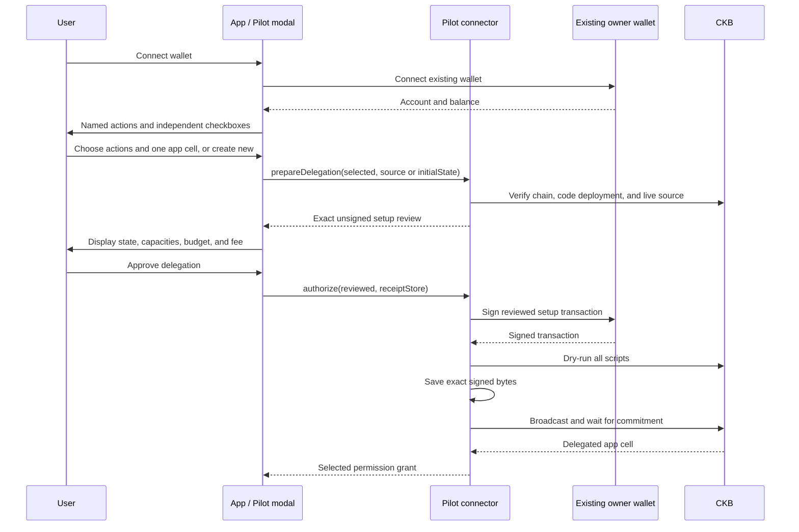
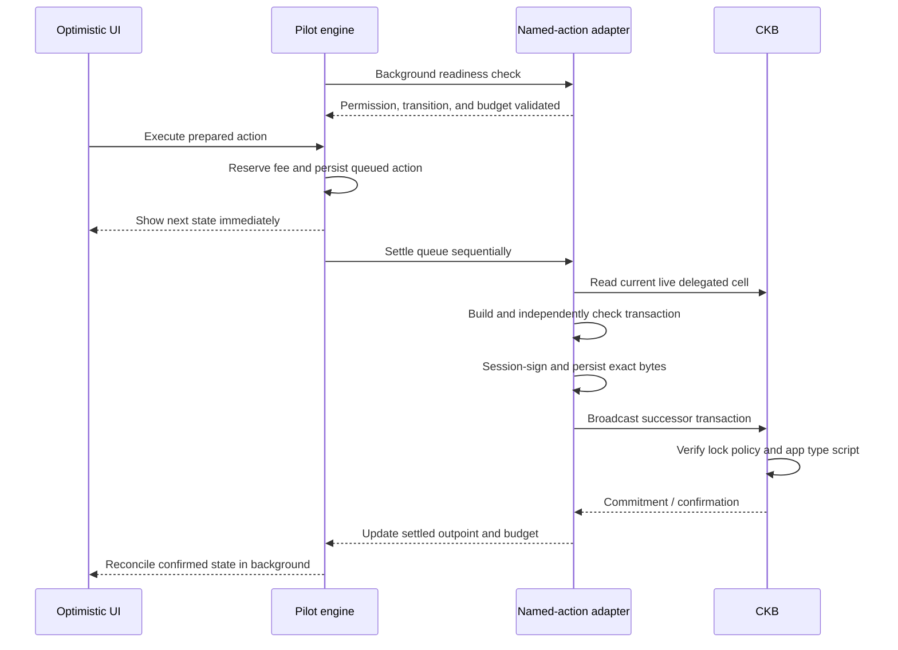

# Pilot cell delegation

Implementation record for the developer-defined action and selected-cell delegation flow. This is implemented SDK, UI, and CKB contract code, with a real local-chain proof. The reusable lock has **not** been deployed to public testnet; the browser example requires a real testnet deployment before it can authorize a cell.

Pilot wraps an existing owner wallet through CCC. It generates a separate session key for automatic actions; it does not replace the owner's wallet or require its private key. The owner approves the initial on-chain delegation and retains an owner-signing path for manual actions and recovery.

## What was implemented

| Component | Implementation |
| --- | --- |
| Developer app definition | `definePilotApp()` combines a version-2 manifest, lossless state codec, named action validators, optimistic reducers, and transaction builders. |
| Readable permissions | Each action has an ID, name, description, operation label, and explicit transition rule. |
| Contract identity | Optional app type script includes its role, code hash, hash type, arguments, and code-cell dependency. |
| Selected cell | Discover matching owner cells, explicitly select an outpoint, or create a new app cell. Pilot never delegates the whole wallet. |
| Selected permissions | Users select actions independently; only the selected subset enters the delegated cell's lock arguments. |
| Owner-only actions | `delegation: 'owner-only'` prevents automatic approval and excludes the action from modal checkboxes. |
| Review before signing | Setup review binds source, state, type identity, owner, selected actions, capacities, fee budget, setup fee, and transaction hash. |
| Independent validation | Pilot checks builder and signer effects against the reviewed cell and declared transition. |
| On-chain enforcement | New `delegation-v1` CKB lock verifies session signatures, selected actions, exact state changes, fees, and protected capacity. |
| Optimistic execution | The existing engine reserves budget and persists acceptance before exposing the optimistic state; settlement proceeds in the background. |
| Durable settlement | Exact signed bytes are saved before broadcast; retries reconcile the same transaction. |
| Manual owner transactions | Unapproved and owner-only actions have an explicit owner-signing path. Confirmed results can be adopted into the session. |
| Recovery | Owner authorization returns the app cell with its type, state, remaining capacity, and unused fee budget. |
| React integration | Version-2 modal, independent checkboxes, reviewed setup, connected-without-delegation flow, and actual approved permission display. |
| Browser demo | New Developer cell delegation panel with creation/migration, automatic actions, owner-only jump, recovery, saved receipts, tab lease, queue, and transaction logs. |
| Documentation | Web docs include a Cell delegation page and updated quickstart/API descriptions. |

## Developer setup

Install Pilot into an existing React/npm app using the GitHub installer described in [README.md](README.md). It installs the SDK, React modal, and CCC connector together. No package publication is required.

The complete runnable app factory is [examples/cell-delegation.ts](examples/cell-delegation.ts). The web docs contain an independently typechecked consumer example importing from `@owl/pilot`.

A developer supplies these fields:

| Field | Purpose |
| --- | --- |
| `manifest.version` | `2` for developer-defined delegation. |
| `manifest.app` | Stable app ID, readable name, description. |
| `manifest.network` | `ckb-devnet` or `ckb-testnet`. |
| `manifest.script` | Optional application **type** script: `role`, `codeHash`, `hashType`, `args`, and `cellDep`. |
| `manifest.actions` | IDs, readable names/descriptions, operation labels, fixed transition rules, and optional owner-only designation. |
| `manifest.cellSelection` | Optional exact data length and data prefix for app-cell discovery and selection. |
| `manifest.policy` | `delegation-v1` deployment, per-action fee, initial budget, protected capacity floor, setup/recovery fee caps. |
| `encodeState / decodeState` | Lossless app state ↔ cell-data conversion. |
| `actions[id].validate` | App eligibility and exact action cost. |
| `actions[id].apply` | Optimistic next state. |
| `actions[id].buildTransaction` | Transaction construction, including app dependencies and witnesses. |
| `buildAuthorization` | Optional app-specific creation/migration hook, independently checked afterward. |

For example, an action declaration is:

```typescript
{
  id: 'game.forward',
  name: 'Move forward',
  description: 'Increase position by one.',
  operation: 'forward',
  transition: { kind: 'u64-increment', offset: 0, delta: '1' },
}
```

`operation` is an application label. CKB has no universal function selector that Pilot can discover from a script hash. The developer's builder supplies the transaction and witnesses the application script understands. The declared transition lets Pilot independently check its permitted effects.

The initial reusable policy supports fixed increments and decrements of a little-endian `u64` at a declared byte offset. The example registers `game.forward`, `game.backward`, and owner-only `game.jump`, with corresponding builders. It checks nonnegative/safe integer state and uses an eight-byte codec. Builders can start from `defaultTransaction`; Pilot rejects effects outside the registered rule.

Changing manifest fields changes its commitment. Grant creation rejects unknown, duplicate, or owner-only permissions. An empty selection is valid and requires no funding or signing.

## Connect and delegate



Use `PilotConnector(ownerSigner, app)`:

1. `getAccount()` exposes the existing account and balance.
2. `findDelegatableCells()` discovers cells with the correct owner lock, exact app type identity, selection filters, and lossless codec. Discovery is bounded to 1,000 scanned cells and 100 results per request.
3. `prepareDelegation({ selected, sessionPublicKey, source })` migrates the explicitly selected live cell. Omit `source` and supply `initialState` to create a new cell.
4. Display `prepared.review`. Persist the session key and prepared cell metadata in the application's session store before signing.
5. After explicit approval, `authorize(prepared, setupReceiptStore)` signs, dry-runs, persists, submits, and confirms the setup.
6. `resume(setupReceiptStore)` reconciles saved signed bytes after an interruption without another owner signature.

The review is scoped to the connector and sealed against modification. Concurrent authorization on the same connector is rejected. Unsigned reviews must be prepared again after restarting; signed receipts can resume.

With `selected: []`, preparation returns `mode: 'connected'` before any wallet/RPC work. The user can remain connected without moving funds into Pilot.

### Migrating existing cells

Migration preserves the selected cell's data and type script. The successor has the reviewed protected capacity plus the selected fee budget. If the source has more capacity, the difference becomes ordinary owner change; if it has less, ordinary owner cells provide the required capacity. The source capacity and successor capacity are included in the review.

The initial implementation accepts a source under the connected wallet's recommended owner lock. Extra funding inputs must be empty-data, type-free cells under that same owner lock. Extra outputs must be ordinary owner change. Pilot rejects unrelated app cells, NFTs, payments, duplicate inputs, unexpected state/type changes, and fees above the configured cap.

An optional `buildAuthorization` hook can add app-specific construction details within these constraints. The app type script still executes. If it forbids changing the lock or requires an unsupported multi-cell migration, the current SDK cannot bypass that rule. A compatible app contract or a broader policy/integration is required.

## Automatic actions and budget



`PilotDelegationAdapter.create()` verifies the real deployment, network, session key, selected grant, lock identity, and settlement-journal scope. The engine receives actions shaped as `{ id, params }`; the adapter routes them to registered builders.

Readiness is tied to the current state revision, remaining budget, session expiry, and selected permission. It cannot be permanently set to true. The example prepares candidate forward/backward actions in the background, then refreshes after acceptance or settlement. The engine persists and reserves an accepted action before showing its optimistic effect, preventing rapid clicks from spending the same allowance twice.

The UI can show accepted actions immediately while exposing transaction progress separately in the inspector. Acceptance is optimistic; it does not claim the chain has already committed. Unknown submission failures retain the queue for reconciliation. Definitive rejection rolls back dependent optimistic actions and releases their reservations.

Budget is capacity above the protected floor:

```text
remaining automatic fee budget = live delegated capacity - protected floor
```

The example uses **350 CKB protected capacity + 0.02 CKB fee budget**, with **0.001 CKB per automatic action**: 20 actions before exhausting its initial fee allowance. Setup is an additional owner-paid fee. Actual occupied capacity depends on selected rules, data, and app type; preparation rejects a floor below the cell's occupied minimum.

This original delegation-v1 flow is a self-funded delegated app cell. The separate delegation-sponsored-v1 variant uses the paymaster described in [PAYMASTER.md](PAYMASTER.md). There is no background withdrawal from the user's ordinary wallet. Recovery returns its remaining capacity. The legacy counter example has its own funding layout and remains separate.

## On-chain policy

The new lock source is [contracts/delegation-lock/src/main.rs](contracts/delegation-lock/src/main.rs). Its pinned binary hash is:

```text
0x8c8c113bd94b15da8c70e9c2f739fc462117c5b987963cb7f66dbcfe84bd2b4a
```

Lock arguments commit the owner lock hash, compressed session public key, manifest hash, exact app type-script hash, maximum action fee, protected capacity floor, and selected rules. Each rule binds an action ID hash, transition direction, byte offset, and positive delta. Up to 16 rules are supported.

For a session-signed transaction the lock requires:

- Exactly one input and one successor output.
- Identical lock and type script on the successor.
- Identical data length, with only the declared `u64` field changing by the declared delta.
- A selected action ID and a valid session signature.
- A positive fee within the per-action cap.
- Successor capacity at or above the protected floor.

The signature commits the raw transaction hash, action ID, and every witness, including app type witnesses and appended witnesses. Changing those bytes invalidates authorization.

Owner mode requires an additional input under the committed owner lock. Its normal wallet script proves owner authorization. Application type scripts execute on both the session and owner paths.

## Manual actions and recovery

An action marked `owner-only` cannot be selected. An otherwise delegatable action left unchecked also cannot use the session path.

Use `prepareOwnerAction()` for an explicit owner-signed action. It supports both a delegated app cell and an ordinary owner-locked app cell without a funded session. The named builder and declared transition are still checked. Owner transactions on a delegated cell preserve its capacity; an ordinary owner input pays the separate fee.

When a session is active:

1. Drain the automatic queue before preparing a manual operation or recovery.
2. Review the prepared transaction, including its fee, output capacity, state, and hash.
3. Call `submitOwnerDelegationTransaction(owner, transaction, kind, receiptStore)`.
4. For a manual action, call `adapter.adoptOwnerAction(hash, actionId)` to verify and adopt the committed successor.
5. Call `pilot.reconcileConfirmed(state, remainingBudget)` before preparing more automatic actions.

Reconciliation is durable, invalidates old readiness, refuses unresolved queued work, and refuses increased allowances. Adoption is idempotent when recovering from an interruption after an owner transaction was committed.

`prepareDelegationRecovery()` prepares an owner-authorized successor under the original owner lock, preserving the app type, state data, full remaining capacity, and unused fee allowance. Recovery is allowed by the Pilot lock, but the app type script must also permit it. An ordinary owner funding input pays the recovery fee. A saved manual/recovery receipt resumes through `connector.resume()` using its exact signed transaction.

## React modal and demo

`PilotModal` supports both the legacy manifest and the version-2 manifest. Version 2 provides:

- Independent unchecked action permissions, with owner-only actions excluded.
- `onPrepareDelegation` for a separate, concrete review before `onAuthorize`.
- `approvedPermissions` for the actual granted subset; absent permissions do not imply approval.
- `onContinueWithoutDelegation` for a connected account without a funded session.
- Developer-defined app and action names, rather than hardcoded flight labels.

[apps/demo/src/CellDelegation.tsx](apps/demo/src/CellDelegation.tsx) integrates the new flow alongside the legacy counter demo. It includes explicit create/migrate selection, testnet deployment loading, permission review, instant optimistic movement, owner-only jump, recovery review, durable receipts, exact-byte retries, a cross-tab lease, and wallet-change guards. Public deployment metadata is persisted for reloads; session keys remain in this browser's local storage.

The queue/log section displays queued actions and transaction events, including signing, signed bytes, broadcasting, commitment, confirmation, and errors. Keys are not included in exported public proof records or transaction diagnostics. Browser local storage remains prototype key storage; this implementation does not add encrypted key storage or hardware-backed session keys.

The browser example uses testnet and rejects devnet deployment files. Its public deployment is intentionally unset in [deployments/cell-delegation.json](deployments/cell-delegation.json), so the reusable example cannot submit transactions until a real testnet code cell is configured. Browser tests cover the modal/UI using a mocked wallet; they do not establish public-testnet deployment.

## Real-chain verification

Build and run against a local offckb node:

```sh
npm run contracts:build
# Run offckb node in a separate terminal.
npm run delegation -- verify devnet
```

The verifier generates test-only owner/session keys, uses the local faucet, persists signed receipts before submission, and writes public deployment/proof records. Private keys and working journals stay under ignored `.pilot/delegation/devnet`. The script rejects non-devnet nodes.

Public evidence:

- [deployments/cell-delegation-devnet.json](deployments/cell-delegation-devnet.json)
- [deployments/cell-delegation-devnet-proof.json](deployments/cell-delegation-devnet-proof.json)

The completed proof is timestamped **2026-10-13T22:08:53.865Z** and records:

| Check | Observed result |
| --- | --- |
| Empty permission selection | Connected without signing or funding. |
| Existing cell migration | Owner cell at position 5 migrated with only forward approved. |
| Automatic forward | Real committed successor at position 6. |
| Bypass attempt | Valid session-key signature for unselected backward rejected by CKB-VM with code 10. |
| Owner-only jump | Real owner-signed transition to position 8, adopted into the adapter/engine. |
| Recovery | Owner-locked successor preserved state and returned **350.019 CKB**. |
| New cell creation | A separate cell created with both forward/backward approved. |
| Two selected actions | Forward and backward committed, final position 5, remaining budget **0.018 CKB**. |

Validation completed:

- SDK typecheck/build and React/demo production builds.
- 36 passing root tests; one optional PostgreSQL test skipped because no test database URL was configured.
- 22 passing CKB-VM tests, including 12 for the reusable delegation lock.
- Five passing browser tests, including independent permissions and mobile layout.
- Six passing web-doc tests and docs production build.
- GitHub-style consumer installation checked with the built SDK/React packages in an external app, including the documented app definition's TypeScript types.

## Current boundaries

This is a bounded reusable delegation prototype. It supports one delegated app cell per automatic transaction, selected fixed `u64` transitions, up to 16 rules, and devnet/testnet. It does not implement arbitrary contract execution, automatic policy-module discovery, multi-cell state transitions, NFT transfer delegation, top-ups, mainnet, or on-chain session expiry.

The SDK enforces local session expiry; the lock does not enforce a timestamp. Losing access to the session key does not remove the owner's recovery path. Compromise of that key permits the already-approved on-chain actions until recovery, including spending the configured fee budget within policy limits.

Two application compatibility boundaries remain explicit: an existing app type script must allow the owner-signed migration, and it must allow the desired session transitions/recovery. Developers must design or adapt their contracts accordingly. Pilot enforces the supported delegation policy and cannot override another script's validation rules.


## Security review update

Builder/validation inputs are independently cloned; manual owner actions preserve application type witnesses. Restoring a browser delegation checks the connected owner's full lock, and owner-receipt resumption checks owner/app scope before resubmission. Session and owner confirmations are reconciled with the node rather than trusting a saved confirmation flag.

New on-chain setup requires a recognized signature-required owner-lock configuration. ACP and optional/permissionless modes cannot safely use the contract's owner-input-presence authorization. This SDK guard does not repair previously funded unsafe cells or enforce a new contract rule; see [SECURITY_AUDIT.md](SECURITY_AUDIT.md), finding P-02. Contract binaries and code hashes were not changed by this review. On-chain expiry is still local, and the browser demo still lacks isolated session-key custody.

The modal now includes expandable, owner-filtered account activity. The demo wires accepted actions and settlement events into public metadata history using `recordPilotActivity`; custom integrations must wire their own events or supply an `activity` array. The separate queue/debug inspector remains available.

## Sponsored delegation variant

`delegation-sponsored-v1` uses its own code hash and appends the pool lock hash to the original lock arguments. Automatic actions use app input/output zero plus pinned ordinary pool input/change one. App capacity stays identical, while pool capacity loss is the entire network fee and is bounded by `feePerAction`. Users fund protected cell capacity without depositing the virtual fee allowance.

Supply `policy.poolLock` and `{ paymaster }` to `PilotConnector` and `PilotDelegationAdapter`. Owner setup, manual actions and recovery also support pool sponsorship. Owner mode still needs an ordinary signature-protected owner input even when its network fee is zero. Use the same paymaster when resuming durable owner receipts.

The sponsored delegation digest uses `owl-pilot-delegation-sponsored-v1` and normalizes only pool witness 1’s lock to empty, preserving its type witnesses. This permits the pool to co-sign after the session signature; it cannot alter reviewed effects or application/type witnesses. The counter signature format stays separate.

Cumulative sponsored delegation allowance is enforced by the SDK journal, not this lock. The lock enforces the selected state transition, pool identity, unchanged user capacity and per-transaction fee cap; the service enforces persistent per-owner/global daily subsidy caps. The sponsored counter additionally decrements its virtual allowance in on-chain data. Neither variant adds on-chain expiry. New binaries passed CKB VM tests; public sponsored deployments are not configured yet.
