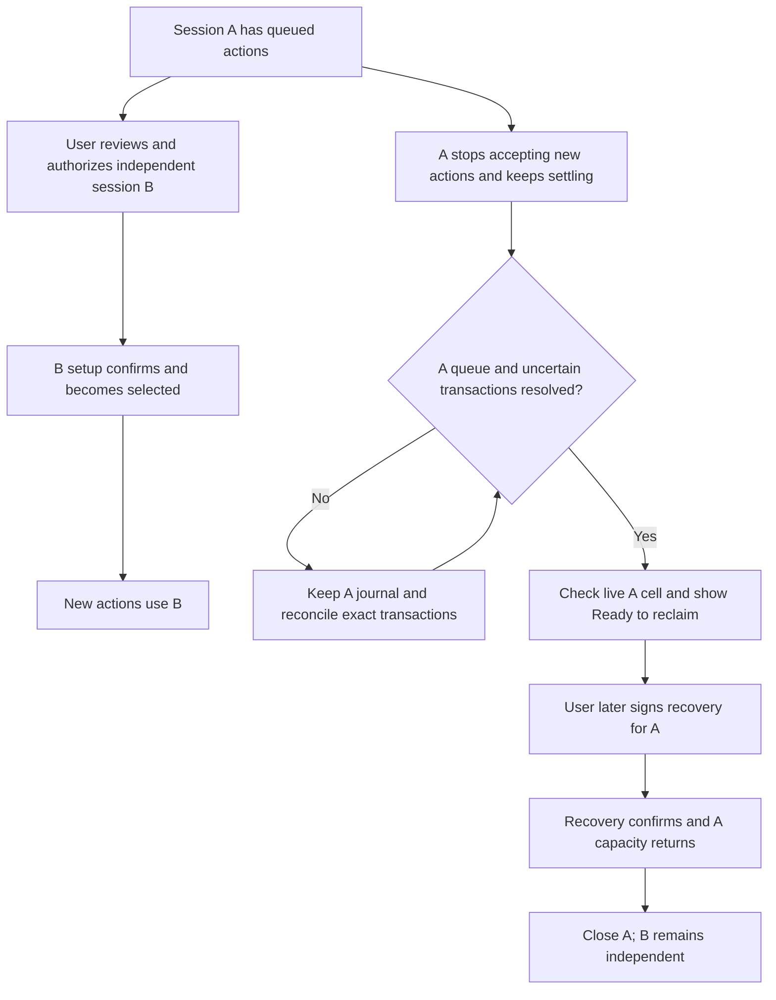

# Pilot V2: developer projects and hosted SDK API

**Status: V2 roadmap, not implemented. Updated 2026-10-23.** The project/dashboard APIs, proposed `PilotProvider` and `createPilotClient`, hosted account discovery, and overlapping-session orchestration below remain proposals. The independent embedded passkey wallet and its `PilotWalletProvider` already exist; they are the baseline, not proposed V2 APIs. This document does not grant new signing authority.

## Goal

A developer creates a Pilot project, registers its app configuration and manifest, and integrates the SDK using a public project ID. Pilot operates username storage and hosted services. Developers manage their projects in a dashboard rather than editing Pilot's deployment environment variables.

An optional server secret authenticates privileged developer operations and authorizes access to project-funded sponsorship. Developers never put this secret, the pool signing key, or database credentials in the browser.

## What exists today

- Existing-wallet connection, modal permission selection and compatible session signing; connection or permission checkboxes alone do not make an arbitrary owner-locked app automatically signable.
- An independent Pilot wallet embedded SDK modal (`apps/wallet`) with native passkey creation/sign-in, multiple local accounts and switching, explicit app-origin/permission/budget review, logs, and owner recovery. JoyID is not required for this path.
- `PilotWalletProvider` and `PilotHostedSigner`: apps receive public account data and request actions over an origin/Window/channel-bound transport; session keys stay on the separate trusted wallet origin, not in integrating apps. Owner private keys stay in the passkey authenticator.
- Passkey and restricted-session contracts deployed on CKB testnet in transaction `0x2fc1cfa4046cdb186eb8ab7adc1cfe19ea3b116a7a5e3480530b73475b0a78be` (outputs 0 and 1), with the original live code hashes verified on 2026-10-23. The embedded SDK modal now replaces the browser popup, and its revised passkey owner contract is deployed in transaction `0x771edc9c5daf2f2e4c40eac48e3fc909f943d9541d59c6863454ede0f015f8d3` (output 0); the unchanged session contract is reused and the old owner code cell has been consumed to reclaim testnet capacity. Recovery through that consumed dependency is unavailable; the historical record is archived as `retiredPasskeyLegacy`. A real hardware-passkey/browser end-to-end testnet flow remains unverified.
- One active session per passkey account, with contract-enforced cell policies, cumulative CKB allowance and owner-authorized replacement/revocation/recovery. Replacement preserves the account address while a live authority exists; closing that authority requires a new account identity for later grants. Expiry remains a wallet/verifier check, not an on-chain upper timestamp limit.
- Compatible CKB session/delegation policies, with separate deployed testnet sponsored variants.
- Username registration with verified wallet ownership and shared storage.
- Paymaster quote/submission validation, fee limits and durable transaction retries.
- Off-chain owner grants, session-signed actions, receiving-app verification, replay protection and revocation.
- Vercel-compatible request handlers and PostgreSQL storage; standalone services can use JSON locally.

Developer projects, dashboard authentication, project secrets, project-bound access tokens, project-specific sponsorship accounting, hosted cross-device account discovery/recovery metadata, overlapping sessions with deferred recovery, and `PilotProvider` are **new work proposed here**. Current React exports include `PilotModal` and `PilotAccountsProvider`; the core SDK also exports the implemented embedded client `PilotWalletProvider`. None is the proposed project-aware React provider below. Local wallet labels are not globally registered Pilot usernames, and existing username records do not automatically discover or migrate passkey session accounts.

The wallet is deployed once on a stable HTTPS origin and shared by integrating apps. The demo/backend and docs remain separate deployments. Browser origin allowlists are the current service configuration; project credentials and a dashboard do not exist yet. See [PILOT_WALLET.md](PILOT_WALLET.md) for the implemented protocol and limits.

## Account creation, discovery and recovery to investigate

**V2 research and design work, not implemented.** Users can already create another wallet directly in the modal, sign in and switch among accounts known to that wallet origin in the same available wallet storage partition. Browsers can partition embedded storage by app or block it; a shared URL does not guarantee a shared local account list. The missing feature is reliable account discovery and restoration on another browser/device, not wallet creation itself.

Investigate these requirements before selecting a hosted directory protocol:

- **Discoverable passkey sign-in:** evaluate a usernameless WebAuthn flow using discoverable credentials and an opaque user handle to find the right public record. Verify credential/RP/origin ownership with a fresh, purpose-bound server challenge before returning private metadata. A credential ID, public key, label or username supplied by a caller is not authentication. Retain an explicit public-descriptor import path.
- **Owner-bound public directory:** associate verified owner credentials with network-specific owner addresses, session-account descriptors/TYPE_ID identities, account labels and archived/recoverable accounts. Decide how existing globally unique Pilot usernames bind to these identities without changing a username's recipient or treating a local label as a registered name. Multiple passkey accounts must remain distinct; account linking needs explicit proofs from the relevant owners.
- **Passkey sync versus metadata sync:** synced passkeys do not sync account descriptors, browser journals or session keys. Discovering an account must work without exporting the passkey private key or uploading raw session private keys. Define behavior for synced credentials, hardware authenticators, credentials unavailable on the device, and unsupported browsers without promising universal sync.
- **Receipts and device coordination:** restore exact signed/submitted transaction bytes and current chain state before replacement or recovery. A missing local journal or server record is not proof that nothing is pending. Investigate authenticated, privacy-preserving receipt backup and cross-device signing/settlement coordination; local Web Locks do not coordinate browsers/devices. Discovery must never resurrect a stale session or double-spend competing state.
- **Recovery and continuity:** with an available original passkey and verified public descriptor, owner recovery already works without the old session key. V2 should make those accounts discoverable and recovery accessible after reconciliation. Losing every usable owner passkey is a separate unresolved recovery problem; metadata backup alone cannot restore signing authority. Additional credentials, owner rotation, social recovery and wallet-domain migration need explicit protocol/contract review before being advertised.
- **Privacy and lifecycle:** prevent unauthenticated enumeration and unauthorized linking of a person's accounts across apps. Define metadata visibility, consent, retention/export/deletion, credential registration/linking/revocation, rate limits and audit events. The wallet stays a separate trusted signing origin; a directory service or developer project secret must not gain spending authority.

Publish a threat model and a supported-browser/device test matrix before choosing an implementation. A changed wallet domain is a changed WebAuthn RP/origin binding; do not treat changing a URL as credential migration. No directory API or schema is finalized by this section.

## Credentials and authority

| Value | Visibility | Purpose |
| --- | --- | --- |
| Project ID, e.g. `pilot_project_123` | Public; frontend-safe | Identifies app configuration, published manifest and API quota context |
| Project secret, e.g. `pilot_sk_test_...` | Developer backend only | Authenticates scoped project management or sponsorship-token issuance |
| Short-lived project access token | Browser-visible bearer token | Grants narrowly scoped hosted API access for a specific project/user/session |
| Owner signature and session signatures | Sent as proofs | Establish wallet ownership, explicit delegation and authorization of actual actions |
| Pool signing key | Pilot server environment only | Co-signs validated fee-sponsored transactions |

The project ID is the publishable identifier for the first version. Calling it a publishable key would not make it a secret or stronger proof. A separate public API key is unnecessary initially.

**A project credential never replaces wallet consent.** A developer secret cannot spend a user's funds, forge owner proofs, expand selected permissions, or bypass a contract's restrictions.

It is impossible to guarantee that only the distributed SDK calls public HTTP endpoints. A caller can inspect browser traffic and reproduce SDK requests. Security comes from verification on the server and chain, not from hiding endpoint names, checking a User-Agent, or including a secret in frontend JavaScript.

## Developer dashboard

Proposed dashboard section: **Developer projects**.

1. Authenticate the developer using a verified wallet ownership challenge. Use a dedicated admin session with expiry, secure cookies and CSRF protections; public project tokens are not dashboard sessions.
2. Create a project with a name, app ID, exact HTTPS origins and initial testnet configuration.
3. Publish a manifest and review its recognized script deployments, action names, rules, limits and content hash.
4. Configure sponsorship mode, per-transaction caps, project/day and owner/day limits, and permitted actions.
5. Create a scoped server secret if the app needs backend-authorized sponsorship or server-side management. Display the secret once.
6. Copy the project ID and integration snippet. View usage, transaction receipts and project audit events.
7. Rotate/revoke secrets, suspend sponsorship, or publish a new manifest version.

Origin allowlists are browser controls and configuration checks; they are not proof that a caller is running the registered app. Project ownership must be checked on every dashboard mutation. Sensitive settings require recent authentication. Never expose pool keys through the dashboard.

Initially, developer projects share Pilot's hosted infrastructure. Per-project quotas allocate an operator-controlled fee pool; a project is not a separate on-chain escrow or deposit account. Dedicated pools and billing are later work.

## Proposed browser SDK

The minimal frontend setup uses only the public project ID:

```tsx
// PROPOSED API — not currently exported.
import { PilotProvider } from '@owl/pilot-react';
import '@owl/pilot-react/styles.css';

export function App() {
  return (
    <PilotProvider projectId="pilot_project_123">
      <YourApp />
    </PilotProvider>
  );
}
```

`PilotProvider` would:

- Load public project configuration from Pilot's hosted API; support an explicit `apiUrl` override for self-hosting and local testing.
- Expose the hosted passkey wallet and supported existing-wallet/account/modal integrations through one project context, while preserving their distinct identity and authorization models.
- Resolve the trusted wallet URL from reviewed configuration and keep passkey/session signing inside the isolated wallet iframe; the project-aware app provider must not import wallet-origin private keys.
- Resolve username, social and paymaster service URLs automatically.
- Check the configured network, manifest hash, supported contract deployments and current app origin.
- Obtain/refresh scoped hosted API access when needed and attach project context to requests.
- Preserve owner-bound account switching, explicit permission selection, durable journals and exact-transaction retries.

A project ID does not supply application transaction-building code. Developers still implement local builders/validators for their app transitions. Published configuration contains declarative rules and script identities, not executable JavaScript downloaded and trusted as signing authority. The SDK checks a local definition against its published manifest hash; the user reviews the actual actions before delegation.

A corresponding non-React entry point is proposed:

```ts
// PROPOSED API — not currently exported.
import { createPilotClient } from '@owl/pilot';

const pilot = await createPilotClient({
  projectId: 'pilot_project_123',
  // apiUrl: 'https://your-pilot-host.example', // optional self-host override
});
```

For a project whose backend authorizes sponsorship:

```tsx
// PROPOSED API — your backend authenticates the user before issuing a token.
<PilotProvider
  projectId="pilot_project_123"
  getAccessToken={async ({ challenge }) => {
    const response = await fetch('/api/pilot-access', {
      method: 'POST',
      headers: { 'Content-Type': 'application/json' },
      body: JSON.stringify({ challenge }),
    });
    if (!response.ok) throw new Error('Pilot access unavailable');
    return (await response.json()).accessToken;
  }}
>
  <YourApp />
</PilotProvider>
```

The SDK supplies a Pilot-issued one-time challenge. The app backend authenticates its own user, verifies the requested owner/session binding and checks its app eligibility policy before using a server secret. It must not turn arbitrary browser input into sponsorship tokens. Tokens should remain in memory, outside URLs, analytics and diagnostic logs.

## Proposed HTTP API

These versioned endpoints are additive. They do not rename or silently secure the existing `/api/pilot`, `/api/paymaster`, or `/api/social` endpoints.

| Endpoint | Authentication and behavior |
| --- | --- |
| `GET /api/v2/projects/:projectId/config` | Public, rate-limited app metadata, manifest/version/hash, network, service URLs and public limits; no credentials or private logs |
| `POST /api/v2/projects/:projectId/challenges` | Public, rate-limited, one-time wallet access challenge bound to project, owner, session key, manifest and expiry |
| `POST /api/v2/projects/:projectId/access` | Verify the challenge's wallet proof; issue a short-lived public-mode token within the project's allowed capabilities |
| `POST /api/v2/projects/:projectId/tokens` | Scoped developer secret plus a valid owner/session challenge; issue backend-authorized access only within project policy |
| `POST /api/v2/projects/:projectId/paymaster/quote` | Scoped access token, bound owner/session and allowed manifest/action; validate transaction and issue project-bound quote |
| `POST /api/v2/projects/:projectId/paymaster/submit` | Same project/owner/session context; verify signatures, quote identity and budgets; commit exact bytes before broadcast |
| `POST /api/v2/projects/:projectId/social/actions` | Scoped access plus an explicitly versioned external-owner grant/action or passkey-wallet scoped message; verify its identity, live authority/revocation, audience/manifest and replay domain before atomically accepting/rejecting |
| `POST /api/v2/projects/:projectId/social/revoke` | Protocol-specific verified revocation proof and appropriate access; distinguish off-chain revocation from passkey-authorized on-chain state revocation, and preserve recovery access when project sponsorship is disabled |
| `GET /api/v2/projects/:projectId/usage` | Developer admin session or scoped reporting secret; project usage and public chain receipt references |
| `GET /api/v2/projects/:projectId/logs` | Authorized project admin or owner-scoped access; redact credentials, session keys and sensitive payloads |
| `POST /api/v2/developer/projects` | Authenticated dashboard admin; create an owned project |
| `PATCH /api/v2/developer/projects/:projectId` | Owning admin or appropriately scoped management secret; update allowed settings |
| `POST /api/v2/developer/projects/:projectId/manifests` | Owning admin or manifest-management secret; publish an immutable manifest version |
| `POST /api/v2/developer/projects/:projectId/keys` | Owning admin with recent authentication; create a secret shown once |
| `DELETE /api/v2/developer/projects/:projectId/keys/:keyId` | Owning admin with recent authentication; revoke the key |

Privileged server requests use `Authorization: Bearer <project-secret>`. Browser requests use `Authorization: Bearer <short-lived-access-token>` where required. Distinct credential types and audiences prevent treating one as another. CORS must allow the required authorization header and only configured browser origins.

Username resolution remains a **Pilot-wide namespace**, rather than one duplicate namespace per project. The SDK can supply project context for quotas and registration challenges, but username claims still require wallet ownership proofs and global uniqueness checks. Registering a name does not approve automatic signing. Recovery/renewal of proofs must never depend on presenting a developer secret in the browser.

## Access and sponsorship modes

### Public integration

A project ID is sufficient to load public configuration and connect wallets. A wallet ownership proof can establish a short-lived project/user context. App developers do not need a backend simply to integrate Pilot.

This proves the user controls a wallet, not that they are an eligible customer of the registered app. Such a token does not authorize privileged management or backend-only sponsorship. Public-mode social writes retain their signed-action and business-rule requirements.

### Backend-authorized sponsorship

For app-funded usage, the developer backend uses its secret to authorize a narrow access token after verifying its app user. Proposed token claims include:

- Issuer, API audience, project ID, token ID, issue time and expiry; initial maximum lifetime five minutes.
- Verified owner lock hash, network and authorized session public key where applicable.
- Published manifest hash and allowed action IDs/capabilities.
- Project credential/policy version for revocation checks.
- Server-derived limits and optional origin binding as an extra browser check.

Pilot signs access tokens with its own server credential, separate from the pool key. The token endpoint intersects requested capabilities with stored project policy. Client-supplied limits cannot raise the project allowance. Wallet proofs, signatures and transaction/script validation remain mandatory.

An explicitly enabled public sponsorship mode may support frontend-only apps. It must use a separate bounded subsidy policy and quotas; a copied project ID or a fake Origin header cannot be prevented from attempting valid requests. Public sponsorship must not silently consume a developer's backend-only allowance.

## Signing and settlement flow

```mermaid
sequenceDiagram
    participant Dev as Developer dashboard
    participant App as App and Pilot SDK
    participant Wallet as Pilot embedded wallet or supported owner wallet
    participant Backend as Developer backend (optional)
    participant API as Hosted Pilot API
    participant DB as PostgreSQL
    participant Chain as CKB

    Dev->>API: Create project, publish manifest and limits
    API->>DB: Save project policy and credential digests
    App->>API: Fetch config using public project ID
    API-->>App: Published manifest/hash and service configuration
    App->>Wallet: Review permissions and authorize session
    Wallet->>Chain: Confirm owner-authorized grant when required
    Wallet-->>App: Public account and grant references, never private keys
    App->>API: Request one-time project/owner/session challenge
    opt Backend-authorized sponsorship
        App->>Backend: Request app access for challenge
        Backend->>API: Authenticate with secret and authorize verified user
        API-->>Backend: Short-lived scoped token
        Backend-->>App: Token, never developer secret
    end
    App->>API: Quote transaction with project context and proofs
    API->>DB: Check project, owner, pool limits and quote identity
    API-->>App: Exact transaction quote
    App->>Wallet: Request permitted action with stable request ID
    Wallet->>Wallet: Verify quote, current authority and policy; sign and persist exact bytes
    Wallet->>API: Submit signed transaction and original quote
    API->>Chain: Validate all scripts before exposing pool signature
    API->>DB: Atomically commit signed bytes, pool lease and accounting
    API->>Chain: Broadcast committed transaction bytes
    API-->>Wallet: Submitted transaction identity
    Wallet-->>App: Public receipt and signing/settlement status
    Chain-->>Wallet: Background chain confirmation
```

The existing optimistic engine still accepts prepared actions locally and renders immediately. A project token, quote or balance check does not mean chain confirmation or reserve funds several moves into the future. Backend errors retain the saved action for reconciliation; a definitive failure follows the existing rollback rules. Requoting must never change an unresolved signed transaction's identity without proof that it cannot settle.

## Start another session while an older session settles

**Proposed V2 behavior, not implemented.** The current passkey account has one active authority/key; replacement stops signing and settles saved receipts before rotating it. This section requires independent compatible account/state identities or a reviewed contract change; a new key alone cannot create two active sessions on the same singleton. Existing app ownership does not automatically move to a second account. A user may explicitly authorize a new session without waiting for their previous session’s accepted actions to settle. Starting another session must not discard, overwrite, or recover the previous session’s cell or queue.

Each session has its own ID, session key, approved manifest and permission subset, budget, durable queue, settlement journal, and current cell outpoint. The new session needs an independent compatible app cell and sufficient wallet capacity. Never fund it from an older session’s unresolved cell, reuse an unresolved owner input, or spend the same app cell from two queues. If an app requires a single shared state cell, its compatible policy must support independent sessions or the new session must wait for that cell to become available; this feature cannot bypass application contract rules.

The modal offers **Start new session** separately from **End session & reclaim CKB**. Creating the new session requires fresh permission/budget review and owner authorization. After its setup confirms, new app actions go to the selected new session. The older session enters **Settling**: it accepts no new actions, while its existing queue continues to reconcile exact saved transactions. Settlement remains sequential within each session. Independent sessions may progress concurrently only when their inputs and app state do not conflict, with shared owner/project/pool limits enforced across them.

Show an owner-filtered session list with permissions, remaining allowance, protected/recoverable capacity, queue count, transaction status, and retry/recovery controls for each session. All state and logs must bind project/app, network, verified owner, and session ID; changing the active session or account must not relabel another queue. A local queue count alone is not proof that a cell is safe to recover: reconcile submitted and uncertain setup/action transactions and check the current live cell first. A definitive rejection may roll back actions under the existing rules; never require an impossible action to confirm or silently discard unresolved work.

Once an older session’s queue is resolved and its current cell is recoverable, mark it **Ready to reclaim**. The user can return later and approve **Reclaim CKB** without ending the new session. Recovery uses the old session’s current outpoint and original authority, preserves required app state, returns recoverable capacity under the contract rules, and records the receipt under that session. Network fees follow the applicable self-funded or sponsored recovery policy. Block new actions and competing recovery while recovery is in flight; persist its signed bytes before submission and retry the same transaction after interruptions. Reclaimed sessions become **Closed** only after confirmed recovery.

Do not automatically reclaim a cell merely because a new session was created. Fresh owner consent is required for recovery. Token expiry, project suspension or switching the active session must preserve an authenticated path to reconcile and recover older sessions. Retain pending journals across reloads and provide session discovery/recovery metadata so older recoverable cells are not hidden by the newest session. Hosted records must never store raw session private keys or treat server-reported status as a substitute for chain verification. Discovery alone cannot resume an unsigned action when its browser-held signing key is unavailable; expose that limitation and a safe owner recovery path after resolving any submitted transactions.



## PostgreSQL model and isolation

Proposed additional tables:

| Table | Required contents/invariants |
| --- | --- |
| `pilot_developers` and admin sessions | Verified developer ownership and expiring/revocable dashboard authentication |
| `pilot_projects` | Owning developer, public project ID, app ID, network, status and credential/policy version |
| `pilot_project_origins` | Exact permitted browser origins per project |
| `pilot_project_manifests` | Immutable normalized manifest versions, content hashes and selected active version |
| `pilot_project_keys` | Key ID/prefix, cryptographic digest, scopes, creation/expiry/revocation times; never raw secrets |
| `pilot_project_challenges` | One-time project/owner/session proofs with purpose and expiry |
| `pilot_project_policies` | Sponsorship mode, eligible actions and operator-approved fee/usage limits |
| `pilot_project_usage` | Atomic project/day and project-owner/day accounting |
| `pilot_project_sessions` | Owner/project/app/network/session binding, manifest and grant references, cell identity/current outpoint, lifecycle, durable transaction/recovery references; no raw session private keys |
| `pilot_project_audit` | Credential/settings changes and redacted action/transaction lifecycle events |

Use cryptographically random, high-entropy secrets; store only digests and verify safely. Separate test credentials from any future mainnet credentials. New mainnet support needs explicit policy and deployment work; a key prefix must not enable it.

Project IDs, issuer/audience and owner bindings must be checked server-side on every operation. Never trust a path parameter or request field to select data without checking the authenticated project and capability. Cross-project quote IDs, tokens, grants, logs and management requests must fail.

Keep **pool-wide coordination** alongside project accounting. Two projects sharing a pool must not acquire independent leases for the same input or bypass the global daily limit. Quote identity must commit the project context as well as complete transaction bytes, including witnesses. Do not equate a raw CKB transaction hash with a unique project authorization.

The existing PostgreSQL journal can be extended or normalized, but pool leases, exact bytes, owner/global/project budgets and retry identity must commit in one transaction before broadcast. An identical retry must not charge any budget twice. Existing signed retries must remain reconcilable after token expiry or policy/key rotation without permitting a new transaction or extra spending; recovery must authenticate the original owner/project and expose only the original authorized result.

Username uniqueness remains global. Social state/replay domains must bind the registered app/audience and project association; adding a mutable project ID to an otherwise valid signed envelope is not sufficient. Bind new project-specific claims in a versioned signed format or an independently verified server-side authorization record. Existing off-chain grants need explicit compatibility handling rather than silently changing their signed content.

## Manifest changes and revocation

A developer's published manifest is configuration, not blanket user consent. Changes to actions, limits, scripts or manifest hash require a new version and fresh user review when they change authorization. Never silently expand a live grant.

Project suspension or secret revocation blocks new hosted privileges and sponsorship according to policy. Existing short-lived tokens must be checked against current project/key status; expiry alone is insufficient for immediate suspension. Keep signed transaction recovery available under the original authority without creating a new spend.

These controls do not revoke a copied on-chain session key. Existing contracts enforce their own lock arguments and rules; dashboard settings do not retroactively change them. For the passkey wallet, owner-authorized on-chain state replacement or explicit revocation invalidates the old key; recovery can close the authority. Disconnect alone only stops this wallet instance and does not revoke a copied key. Earlier delegation protocols retain their own owner-recovery rules. Signed off-chain revocation follows its existing grant-specific verification path. Project authentication does not make arbitrary CKB contracts compatible with Pilot.

## Implementation order

1. Add project ownership/admin authentication, tables, immutable manifests, policy validation and scoped secret creation/rotation.
2. Add public configuration and project challenge/token endpoints with wallet/session binding, expiry and suspension checks.
3. Add project-aware hosted API authorization and atomic project-plus-pool accounting. Keep existing SDK signature/quote checks.
4. Add `createPilotClient` and `PilotProvider`, retaining current explicit integration as a supported path during migration.
5. Define the discovery/recovery threat model and supported device matrix; implement authenticated public metadata/receipt discovery, safe credential/account linking and cross-device coordination without uploading session private keys.
6. Add owner-bound multiple-session storage, selection, background reconciliation, session discovery, and deferred recovery controls; verify independent cell/input handling, account-identity continuity limits and aggregate sponsorship limits.
7. Add dashboard creation/settings/usage/logs, then integrate the demo as a registered project.
8. Update README and web docs alongside each implemented change; keep proposal examples visibly separate from available APIs.

During migration, protect the old unscoped sponsorship endpoints or disable them for the managed pool. They must not remain an alternate route around project limits. Unresolved old signed transactions require a documented recovery path; do not discard their journal entries. Moving endpoints must preserve username mappings, social replay/revocation state, pool leases and fee accounting.

## Acceptance criteria

- A returning user on another supported browser/device can authenticate an available passkey and discover only their verified accounts, with network/identity bindings checked against chain state; credential IDs or names alone reveal no private directory records.
- New wallet creation and account switching remain available in the shared modal; a local label is never silently promoted to a global username or used to retarget payments.
- Restoring metadata neither exports owner/session private keys nor implies restored session signing; unavailable session keys lead to explicit replacement/recovery after uncertain transactions are reconciled.
- Concurrent devices cannot use stale restored authority or missing local journals to bypass settlement and recovery checks. Loss of all owner credentials remains explicitly unsupported unless a separately reviewed recovery protocol is implemented.
- A developer can create a project, publish its manifest, copy the public ID and connect an app without handling Pilot's database or pool secret.
- The public ID appears safely in frontend assets; developer secrets and pool credentials do not.
- A copied ID cannot manage a project or obtain backend-only sponsorship without the required proofs and developer authorization.
- Tokens, challenges and quotes reject a different project, owner, session key, manifest, audience or action.
- SDK bypass, forged Origin headers and manually constructed HTTP requests cannot skip signature, business-rule, transaction or budget validation.
- Concurrent instances/projects cannot double-lease pool inputs or overspend project/owner/global limits.
- Exact retries after lost responses return original bytes/receipts and charge once, including after a cold start.
- Expired/revoked credentials block new privileges while preserving authenticated recovery of already-signed transactions.
- Dashboard users cannot read or modify another project's settings, secrets or private logs.
- Permission expansion requires fresh consent; account switching cannot reuse another owner's token or session.
- A user can authorize an independent session B while session A has unresolved actions; B never consumes A’s cell or unresolved owner inputs, and A continues reconciling its original queue.
- Session selection, account switching and reloads preserve distinct owner/app/session queues, permissions, budgets and receipts; only the selected accepting session receives new actions.
- An app requiring a shared state cell cannot start conflicting sessions without a compatible policy; concurrent independent sessions still respect owner/project/pool limits.
- Once A’s queue and uncertain submissions are resolved, its recoverable capacity remains discoverable and reclaimable with owner approval while B continues independently.
- Recovery is blocked by unresolved conflicting transactions, uses A’s verified current outpoint, retries exact saved bytes after interruption, and closes A only after confirmation. Repeated recovery cannot spend twice or affect B.
- PostgreSQL failures fail closed, with no temporary-file fallback; local and Vercel integration tests cover authorization, concurrency and recovery.

This is the intended V2 design. It does not claim the developer dashboard, credentials, tokens or proposed SDK exports are available in the current release.
