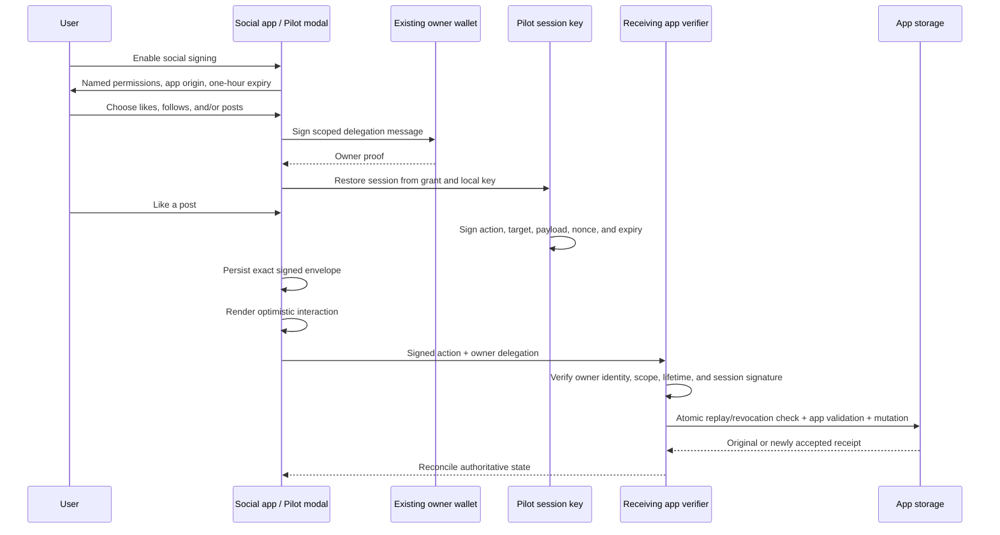

# Off-chain signing with Pilot

Pilot now supports owner-approved delegation for off-chain messages, separately from its CKB transaction permissions. The SDK, React consent modal, social demo, and optional shared verifier are implemented.

A like, follow, or post carries a real session-key signature and the original owner-signed delegation. The receiving app verifies both before updating its state. No CKB transaction, fee budget, username registration, or local CKB node is required for this flow.

## User flow



The owner signs once to establish a grant, then signs again only when explicitly revoking it. Subsequent selected actions use the session key. A connected wallet alone grants no automatic permissions. Off-chain approval cannot spend wallet funds or exercise a CKB cell-delegation grant.

## SDK API

Implementation: [src/offchain.ts](src/offchain.ts).

| API | Purpose |
| --- | --- |
| `OffchainManifest` | App ID, readable name, exact audience origin, and readable action declarations. |
| `authorizeOffchain(owner, manifest, options)` | Owner-sign a delegation for selected IDs, session public key, and expiry. |
| `offchainGrantMessage(grant)` | Human-readable, domain-separated owner message containing the canonical grant. |
| `offchainManifestHash(manifest)` | Commitment to the reviewed app/action manifest. |
| `offchainGrantId(grant)` | Content commitment binding the complete grant, including owner and session key. |
| `PilotOffchainSession.create(...)` | Verify the grant and restore a session using its matching private key. |
| `session.sign({ id, target, payload })` | Sign a JSON action locally with a fresh nonce and short expiry. |
| `verifyOffchainAuthorization(...)` | Verify the owner proof, address binding, manifest, and scope. |
| `verifyOffchainAction(...)` | Verify cryptography and scope only; does not consume a nonce or consult revocations. |
| `acceptOffchainAction(envelope, { manifest, store })` | Verify, then invoke the application's atomic acceptance store. |
| `revokeOffchain(owner, authorization, manifest)` | Create an owner-signed revocation message. |
| `acceptOffchainRevocation(request, { manifest, store })` | Verify owner revocation and record it through the store. |
| `offchainCanonical(value)` | Strict canonical JSON encoding used for commitments and signatures. |

`OffchainAcceptanceStore<Receipt>` requires two methods:

```typescript
interface OffchainAcceptanceStore<Receipt> {
  accept(envelope: OffchainEnvelope): Promise<Receipt>;
  revoke(request: OffchainRevocation): Promise<void>;
}
```

The SDK verifies before invoking those methods. A server must use its own trusted manifest and audience. `accept()` must perform revocation checking, nonce uniqueness, application-specific validation, expiry rechecking, and the app mutation in one transaction. Exact retries return the original receipt; reuse of a nonce with changed content fails. Calling `verifyOffchainAction()` alone is insufficient for accepting mutations.

The example implementation is [server/offchain-social.ts](server/offchain-social.ts), with app rules in [examples/offchain-social.ts](examples/offchain-social.ts). Its store uses a cross-process file lock and atomic rename, so parallel requests and server restarts preserve replay and revocation state. The HTTP endpoints are:

| Route | Behavior |
| --- | --- |
| `GET /api/social/manifest` | Configured demo manifest and audience. |
| `GET /api/social/state` | Public like/follow state, posts, and the latest 100 receipts. |
| `POST /api/social/actions` | Verify and atomically accept a signed social action. |
| `POST /api/social/revoke` | Verify and durably record owner-signed revocation. |

Likes/follows use explicit `{ enabled: true/false }` payloads, rather than ambiguous toggles. The demo restricts them to its introduction post and Owl account. Publishing requires a text payload of 1–280 characters for the demo feed. An action signature alone does not establish that a target exists or that a business operation is valid; the receiving app enforces those rules.

## Signing example

```typescript
import { ccc } from '@ckb-ccc/core';
import { secp256k1 } from '@noble/curves/secp256k1.js';
import { authorizeOffchain, PilotOffchainSession } from '@owl/pilot';

const manifest = {
  appId: 'my.social',
  name: 'My Social',
  audience: window.location.origin,
  actions: [{
    id: 'social.like',
    name: 'Like posts',
    description: 'Like or unlike a post.',
  }],
};
const privateKey = ccc.hexFrom(secp256k1.utils.randomSecretKey());

// Show the manifest and obtain explicit permission selection first.
const authorization = await authorizeOffchain(ownerSigner, manifest, {
  selected: ['social.like'],
  sessionPublicKey: ccc.hexFrom(secp256k1.getPublicKey(ccc.bytesFrom(privateKey), true)),
  expiresAt: Date.now() + 3_600_000,
});
// Persist privateKey and authorization in your application's session store.
const pilot = await PilotOffchainSession.create(authorization, manifest, privateKey);

const envelope = pilot.sign({
  id: 'social.like',
  target: 'post-123',
  payload: { enabled: true },
});
// Persist this envelope before submitting; retry the same envelope after a timeout.
```

Grant lifetime is capped at seven days. The demo chooses one hour. Each signed action has a lifetime of at most five minutes, bounded by the grant's expiry. Payloads are strict JSON and at most 16 KiB; envelope and nesting limits also apply. There is no per-action CKB fee budget for these messages. Application rate limits and other business constraints belong in the receiving app.

## Permission and identity enforcement

A grant commits the complete manifest, exact app origin, owner identity/address/network, session public key, selected action IDs, grant nonce, and timestamps. An action commits the grant's full content hash, origin, app, ID, target, payload, nonce, and timestamps. Grant content hashes prevent another owner from copying a public grant nonce to collide with its replay or revocation records.

Signatures use separate domains for manifests, grants, actions, and revocations. Canonical JSON rejects BigInt, undefined, non-finite numbers, class instances, and excessive nesting. Altering permissions, labels, target, payload, origin, or timestamps invalidates the corresponding authorization/signature.

The shared wallet identity verifier is [src/wallet-identity.ts](src/wallet-identity.ts). It derives acceptable CKB recipient locks from the signing identity. It shares the existing username identity rules for CKB, EVM, Bitcoin, Nostr, Dogecoin, and primary JoyID passkeys. JoyID proof fields are whitelisted before verification to prevent replacing the signed challenge or credential identity. This reuses identity verification; it does not require registering a username.

Revocation is effective when the receiving app records it. Afterward even a previously signed, unaccepted action is rejected. Disconnecting, closing the modal, or deleting a local key is not server-side revocation. Expired grants cannot authorize accepted actions; browser clocks and verifier clocks should be synchronized.

## React integration and demo

[packages/react/src/PilotOffchainModal.tsx](packages/react/src/PilotOffchainModal.tsx) exports the separate `PilotOffchainModal`. It renders unchecked named permissions, the app origin, connected owner address, expiry explanation, and approval/decline controls. No funding or spending consent is mixed into this UI.

[apps/demo/src/OffchainSocial.tsx](apps/demo/src/OffchainSocial.tsx) adds a **Pilot Social** panel with likes, follows, posts, reload recovery, revocation, and signed-message diagnostics. Only selected actions are enabled. A signed request is persisted before optimistic rendering and submission. While a request is unresolved, another action cannot overwrite it. Unknown failures retain the exact envelope for retry. Expired work can be cleared after refreshing the feed so any earlier accepted effect remains visible.

The inspector and JSON diagnostic export include public grants, signatures, receipts, pending envelopes, and event/error logs. They exclude the session private key. The prototype stores that key in browser localStorage; it is not an encrypted or hardware-backed key vault.

### Static hosting

Build the demo and serve `apps/demo/dist` over HTTPS:

```sh
npm run build --prefix apps/demo
```

Without `VITE_PILOT_SOCIAL_URL`, the social panel is labelled **BROWSER-LOCAL DEMO**. Wallet and session signatures are real, and it uses the same SDK verifier, but its feed is stored and verified within that browser. Local storage can be edited by the user and is not an authoritative shared service. This mode is useful for demonstrating the signing flow without running any backend or CKB node.

Use **Enable social signing** inside the social panel. Other app panels still have their existing username/on-chain requirements.

### Shared backend hosting

For a shared feed, use a Node host with a persistent writable volume:

```sh
PILOT_SOCIAL_AUDIENCE=https://demo.example \
PILOT_SOCIAL_FILE=/persistent/pilot-social.json \
npm run social
```

The server binds `127.0.0.1:5181` by default. Route `/api/social/*` to it through an HTTPS reverse proxy. Host/port can be set through `PILOT_SOCIAL_HOST` and `PILOT_SOCIAL_PORT`. Do not place the data file in the static site's public directory.

Set the public API URL before building the frontend:

```sh
VITE_PILOT_SOCIAL_URL=https://api.example/api/social \
npm run build --prefix apps/demo
```

The audience must be the exact frontend origin: no path or trailing slash. Production requires HTTPS; HTTP is permitted only for localhost development. A configured backend failure never silently falls back to local acceptance. The demo checks that the backend's configured manifest matches before requesting owner approval.

For local shared-mode development, use audience `http://127.0.0.1:5174` (the default) and frontend URL `http://127.0.0.1:5181/api/social`.

Vite environment variables are public build configuration, never credentials. The social service does not start a CKB node. Its JSON store is for one demo service on a persistent filesystem; deployers using ephemeral/serverless or multi-region infrastructure must supply a durable transactional store. The sample caps accepted receipts and revoked grants at 10,000 each rather than silently deleting replay protection.

## Verification

Run:

```sh
npm run check
npm run build --prefix packages/react
npm run build --prefix apps/demo
npm test --prefix apps/demo
npm run build --prefix apps/docs
npm test --prefix apps/docs
```

New SDK/backend tests exercise real generated CKB owner signatures and session signatures, selected permissions, altered payload/target/signature rejection, origin and manifest binding, owner-address spoofing, expiry, canonical JSON, concurrent exact retries, conflicting nonce reuse, persistent revocation, HTTP validation, and cross-owner grant-ID collision isolation.

Browser tests exercise a real EVM signing fixture through CCC: one owner signature approves likes/posts, subsequent actions add no owner signatures, unselected follow remains disabled, reload restores the grant, diagnostics exclude keys, and owner revocation requires a second signature. Another test confirms declining creates no owner signature. A separate shared-backend browser check also exercised a deliberately lost response after acceptance, reload, an exact-envelope retry with no duplicate receipt, publishing, and revocation.

The new flow has not been manually verified with a real browser extension or JoyID UI. Existing on-chain testnet/devnet proofs certify their own flows, not off-chain signing. This feature does not broaden the current on-chain `u64` policy and does not provide decentralized social storage, moderation, or a consensus protocol.


## Connected-account restoration and profile logs

When restoring, bind the valid grant to the **currently connected wallet**, not merely its storage-key name:

```ts
const session = await PilotOffchainSession.create(
  authorization, manifest, privateKey, Date.now, connectedAddress,
);
```

The demo refuses mismatched saved grants, pending actions, and revocations before signing/retry. The optional expected-owner argument is backward compatible; integrating apps must pass it or perform an equivalent account comparison.

Open **Social profile & logs** to inspect recorded actions in the modal. Each action retains its signing and receiver-acceptance timeline across reloads; history is filtered by owner and excludes session keys and arbitrary payloads. The reusable UI reads `recordPilotActivity`'s browser journal or an `activity` prop supplied by the host. This is local diagnostics, not an immutable/global activity ledger. See [SECURITY_AUDIT.md](SECURITY_AUDIT.md).
