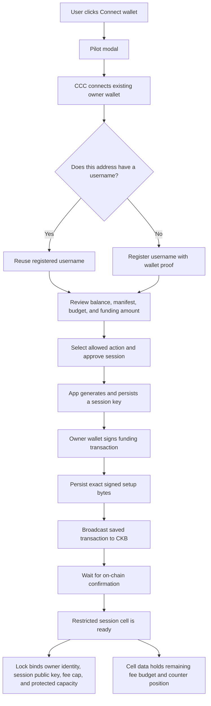
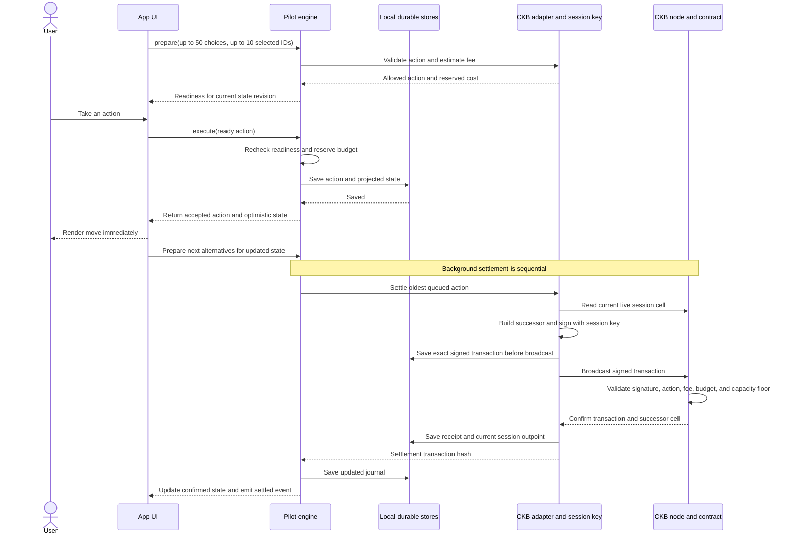
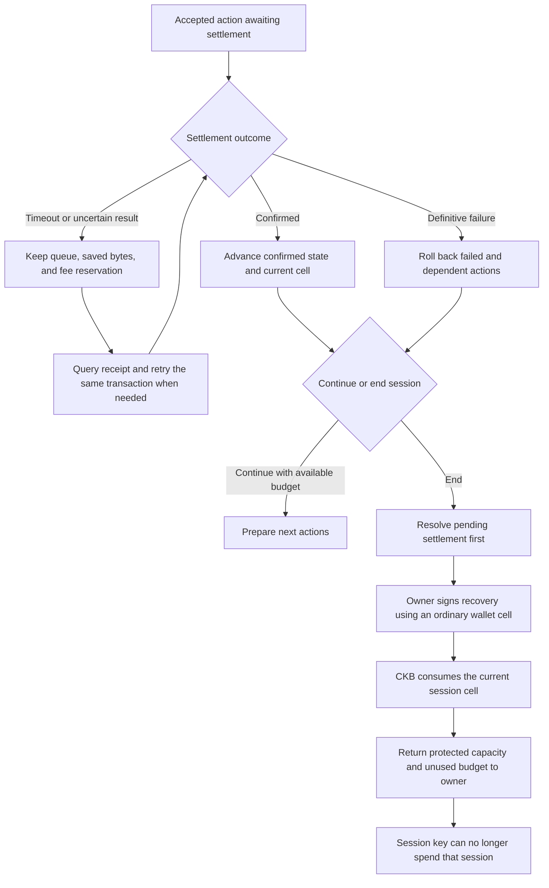

# Pilot

**Owl's Pilot** is a session SDK for CKB apps: approve a bounded session once, then interact instantly while transactions settle in the background.

Pilot includes an optimistic engine, the public-testnet counter integration, and a reusable cell-delegation lock with a developer setup API. Developers register named actions, state codecs, and transaction builders; users choose permissions and a budget, then explicitly create or migrate one app cell. Compatible sponsored policies can use Owl’s paymaster for network fees; scoped off-chain grants support actions without CKB transactions. `npm run demo` remains a simulation; `npm run ckb` and `npm run delegation` can submit real CKB transactions. Connecting an ordinary wallet alone does not grant a session key permission to spend its cells. This remains a bounded testnet/devnet prototype.

## Install into your app

From your existing npm app (Node.js 22+, Git, and curl):

```sh
curl -fsSL https://raw.githubusercontent.com/Birdmannn/owl/main/scripts/install-pilot.mjs | node --input-type=module -
```

The installer automatically includes the SDK, React 19 modal, and CCC wallet connector. It clones a sibling `pilot` checkout if needed, builds it, and installs local package copies. No npm or GitHub Packages publication is needed. If already cloned, run `node ../pilot/scripts/install-pilot.mjs` from your app. Use `--source PATH` for another checkout, `--app PATH` for another app, and `--help` for options.

Keep the checkout available for future installs. To update, pull your chosen revision there and re-run the installer. It refreshes the installed Pilot package copies even when their version is unchanged. The installer sets CCC core to `1.23.0` and `install-links=true` in your app’s `.npmrc`; commit that file and your app’s lockfile. In CI, restore and build the same Pilot revision before installing app dependencies. Wallet connection and app integration are described in the website Quickstart; the installer does not start services or edit app source.

## Run the SDK example

```sh
npm install
npm run check
npm run demo
```


## Pilot passkey wallet and isolated signing

Pilot now includes a separate **passkey-owned wallet preview**, without requiring JoyID. Its SDK modal embeds a dedicated wallet origin in an isolated iframe; Safari alone uses a separate top-level passkey window; other browsers keep authentication embedded. The owner private key stays in the passkey authenticator; session private keys stay on the wallet origin rather than in integrating apps. The existing CCC wallet wrapper and broad-key `PilotAccountSigner` remain separate APIs.

The new `pilot-passkey-lock` verifies user-verified WebAuthn assertions. The new `pilot-wallet-session-lock` requires a singleton built-in TYPE_ID authority on every automatic spend and enforces the approved cell policies, cumulative CKB spending budget, sequence and full fee sponsorship. The passkey owner can replace, revoke or close that authority. These restrictions are enforced on-chain, rather than only by SDK permission labels. App builders and type-script rules still apply.

Use `PilotWalletProvider` and `PilotHostedSigner` from the SDK. The wallet profile shows all account receipts, while app RPC logs are filtered to their requesting origin. A click opens the wallet, the user selects policies and a budget, and the passkey authorizes funding/the session grant. Prepare app effects with `signer.prepareTransaction(tx)` and submit with `signer.sendTransaction(prepared, stableRequestId)`. The wallet persists signed receipts before submission and exposes account logs. Scoped messages use `provider.request('signMessage', ...)` and a receiving API using `verifyPilotScopedMessage` plus atomic replay protection. See [PILOT_WALLET.md](PILOT_WALLET.md) for the integration example, Mermaid flow, exact contract rules and recovery model.

Run `npm ci --prefix apps/wallet` and `npm run dev --prefix apps/wallet` for the wallet on `http://localhost:5176`. The demo includes a separate **Pilot passkey wallet** panel; configure `VITE_PILOT_WALLET_URL` for a hosted wallet. The wallet needs `VITE_PILOT_PAYMASTER_URL`, the configured pool and verified passkey/session deployments. Add the wallet's origin to the paymaster browser allowlist. Its Vercel project root is `apps/wallet`, separate from demo/backend and docs.

The wallet has a dark-only interface matching the demo and docs branding: Owl artwork, forest-green panels and lime accents. Its responsive layout separates account creation/sign-in, explicit app permissions and budget review, session/recovery controls, and expandable queue receipts. Public backup/import tools and technical policy details are expandable; permissions remain unchecked by default.

`PilotWalletProvider.connect()` opens the compact, dark Pilot modal using the original demo’s visual style. Its height follows the current content, including spacing and padding, up to 70vh; longer screens scroll inside the modal. It shows one screen at a time: **Welcome to Pilot → passkey sign-in or account creation → selected permissions and spending budget → profile**. It does not embed the wallet’s full dashboard into the visible modal. The profile contains the address/balance, permission review, expandable queue/receipt logs, session recovery, and public backup/restore. Account names are local labels, not registered usernames. No external-wallet chooser, “Add wallet” or “Add JoyID” step is part of this flow. The modal hides only after the on-chain grant confirms. `provider.open()` reopens account, balance, permission, log and recovery controls; Close/Escape or `provider.hide()` hides the UI while retaining the iframe for approved automatic actions. `disconnect()` settles saved receipts before removing it; failed settlement preserves the connection. Native passkey prompts still appear for authentication/owner authorization. The app must permit the wallet origin in CSP `frame-src` and delegate WebAuthn permissions; strict style CSP can use `styleNonce`. Browsers can partition or block embedded storage/passkeys: the Safari authentication window does not bypass blocked storage or provide shared discovery across apps. See [PILOT_WALLET.md](PILOT_WALLET.md) for hosting, recovery and trust limits.

**Activation and limits:** the unchanged session contract remains deployed on CKB testnet. The revised embedded passkey owner lock is deployed on CKB testnet in transaction `0x771edc9c5daf2f2e4c40eac48e3fc909f943d9541d59c6863454ede0f015f8d3` (output 0), recorded as `passkey` in `deployments/pilot-sponsored.json`. The old testnet owner code cell was consumed to reclaim deployment capacity on 2026-10-23. Its historical record is archived under `retiredPasskeyLegacy`; `passkeyLegacy` is unset. Accounts using that old code dependency cannot spend or recover through it while it is unavailable. No automatic funds/identity migration has occurred. Rebuild/redeploy the wallet, backend and integrating apps with the revised deployment records, then configure hosting and sponsorship before using on-chain setup. Deployment preserves change below the minimum ordinary-cell capacity in the deployer-controlled code cell instead of spending it as a fee. No public-testnet end-to-end success is claimed. Session keys remain accessible to the wallet origin's own scripts. Only one on-chain session is active per account; a larger permission list must fit the existing state-cell capacity or use a funded replacement account. Expiry is enforced locally, while revocation and budget are enforced on-chain. Cross-device metadata/receipt synchronization, social recovery and universal token/NFT recovery are not included. Local account labels are not registered Pilot usernames. The earlier `PilotAccountSigner` browser demo below still has its original broader authority and custody limits.

**Hosted-wallet development:** When embedding the hosted HTTPS wallet, serve the integrating app over trusted HTTPS too, including local development. Chromium/Brave can report “WebAuthn is not supported on sites with TLS certificate errors” for a hosted wallet inside an HTTP localhost page even when the wallet certificate is valid. Use a trusted local certificate or an HTTPS preview deployment; clicking through an untrusted-certificate warning is insufficient. Localhost-to-localhost virtual-authenticator tests do not verify this hosted-wallet configuration. Safari embedded passkey restrictions are handled by a Safari-only top-level authentication window; allow popups when prompted.

## Persistent owner-recoverable Pilot accounts

Pilot also provides a new `PilotAccountSigner` for apps that should use a separate persistent account as the user. Unlike the bounded counter/u64 policies, its account lock accepts general transaction shapes and retains the original wallet as a recovery owner. Apps see the **Pilot address**, not the JoyID address; existing owner-bound app state is not inherited. App type-script rules still apply.

The owner explicitly funds a CKB spending budget plus the account cell's occupied capacity. Rewards addressed to Pilot stay in that account. Every automatic transaction requires per-transaction sponsorship: user inputs balance user outputs, and a pinned pool input/change pays the entire network fee. There are no fee-balance top-ups or silent user-paid fallbacks. The service registers an account only after owner-authorized funding commits; copying another owner hash does not grant sponsorship. The SDK checks that the active owner still matches the account, and requires an approved action and an app-specific effect validator before signing, persists exact bytes before submission, and reconciles unresolved transactions before another spend or recovery. Message signing also checks an approved validator and records a payload hash. Backends use `verifyPilotAccountMessage` for the new account key and `verifyPilotAccountOwnership` with a committed funding receipt when trusting a link to the original owner. They must enforce their own replay rules.

`PilotAccountSigner.create()` takes an owner signer, verified deployment, pinned pool, fee cap, key store, journal store, exclusive lease, action definitions and selected permissions. Use `account.forAction(id).sendTransaction(tx, stableRequestId)` (reuse the request ID on retries) or `.signMessage(message)`. Do not use raw `signTransaction()` to bypass sponsored settlement. `fund(capacity)` requests owner approval, `stop()` stops new automatic signing, `resume()` reconciles receipts, and `recover()` stops signing, settles pending work and asks the owner to recover ordinary CKB. `preparePilotAccountRecovery(owner, publicDescriptor)` and the durable sponsored `recoverPilotAccount(...)` work without the Pilot key or journal; typed assets need compatible recovery builders. Export the public descriptor before funding.

The demo includes a **Persistent Pilot account** panel with a funding review, selectable payment/message permissions, recovery descriptor download and detailed receipts. **The new account lock is compiled and VM-tested but not deployed** (`deployments/pilot-sponsored.json` has `account: null`), so the panel blocks setup until its deployment and sponsorship are configured. Deployment instructions and the corrected sequence diagram are in [CURRENT_IMPL.md](CURRENT_IMPL.md).

The first demo keeps keys and journals in browser storage. Its stable account mapping is limited to that browser origin and network; cross-browser/device discovery and an isolated signing service are not implemented for this earlier API. The separate passkey-wallet preview above provides a dedicated signing origin. No persistent account keys are added to PostgreSQL or the username registry, and usernames still resolve to their existing registered owner address. Treat this as testnet custody: app JavaScript can access keys, and SDK permissions are not on-chain spending restrictions. The account key has broad spending power; owner recovery does not prevent it from spending first. Recovery only removes its authority over cells actually recovered, not future deposits to the old address.

## Run the browser demo and docs

Install the repository dependencies once:

```sh
npm ci
npm ci --prefix packages/react
npm ci --prefix apps/demo
npm ci --prefix apps/docs
```

Run each service in its own terminal from the repository root:

```sh
npm run registry
npm run dev --prefix apps/demo
npm run dev --prefix apps/docs
```

The demo opens at `http://127.0.0.1:5174`; the docs open at `http://127.0.0.1:5175`. The demo proxies username requests to the local Pilot service on port 5180. No local CKB node is needed for the browser’s testnet flow. Wallet registration requires a signed proof; on-chain sessions also require test CKB for their cell capacity and any user-paid fees.

The demo defaults to self-funded counter sessions and browser-local social state. To use a shared social backend or fee sponsorship, configure their public frontend URLs before starting or building the demo; see [OFFCHAIN_SIGNING.md](OFFCHAIN_SIGNING.md), [PAYMASTER.md](PAYMASTER.md), and [.env.example](.env.example). Root service scripts load the root `.env`; Vite frontend variables belong in the app’s environment or `apps/demo/.env`. Never expose server private keys through `VITE_` variables.

Docs demo links open the [hosted Pilot demo](https://owl-pilot-demo.vercel.app) by default. Set `VITE_DEMO_URL` when building or serving the docs to override that destination, for example `http://127.0.0.1:5174` for local development. The SDK’s `npm run demo` command runs a simulation; it does not launch either website.

## Off-chain social signing

Pilot also supports scoped message delegation for likes, follows, posts, and other app-defined off-chain actions. The owner signs a grant once; `PilotOffchainSession` signs selected actions with a separate key. The receiving app verifies owner and session proofs and atomically enforces replay protection, revocation, and business rules. No CKB transaction or fee budget is required for these messages.

The demo’s **Pilot Social** panel works in explicitly labelled browser-local mode on a static HTTPS host. For shared state, use the included persistent verifier through `npm run social` or the Vercel `/api/social` handler; configure its exact app audience and set `VITE_PILOT_SOCIAL_URL` before building. An unavailable configured backend does not silently fall back to browser-local acceptance. See [OFFCHAIN_SIGNING.md](OFFCHAIN_SIGNING.md) for APIs, diagrams, hosting, and verification limits, and the website’s **Off-chain signing** page.

## Set up your app for cell delegation

Use `definePilotApp()` to supply a version-2 `PilotAppManifest`, `encodeState()`/`decodeState()`, and one `validate()`/`apply()`/`buildTransaction()` builder per named action. The manifest specifies human-readable names, operation labels, optional app type-script identity and cell dependency, cell-selection rules, transitions, deployment, and fee/capacity limits. See the complete [developer example](examples/cell-delegation.ts), [implementation guide](CELL_DELEGATION.md), and the website’s **Cell delegation** page.

`PilotConnector.prepareDelegation()` builds a review for a new app cell or an explicitly selected owner-locked cell. `authorize()` requests the owner signature only after review and persists signed bytes before broadcast. Empty selection stays connected without funding. The reusable lock commits the chosen subset and enforces it on-chain; an owner-only action cannot enter a grant. The selected app’s type script must allow migration and recovery; Pilot cannot bypass its rules. Preparation and transaction validation reject incompatible effects, and the app script still validates any submitted transaction.

`PilotDelegationAdapter` routes `{ id, params }` actions to the registered builders and independently checks their effects before session signing. The current lock supports fixed increments/decrements of a declared u64 field, preserving all other data, the app type script, the lock, and protected capacity. It does not support arbitrary multi-cell or NFT transitions. The SDK also provides reviewed owner-signed actions, confirmed-state reconciliation, and recovery that preserves app state and returns ownership.

Build and verify locally:

```sh
npm run contracts:build
# Separate terminal: offckb node
npm run delegation -- verify devnet
```

The verifier uses generated, ignored test keys and local faucet funds. Public evidence is in [the devnet proof](deployments/cell-delegation-devnet-proof.json). The browser demo includes a **Developer cell delegation** panel with selectable actions, explicit creation/migration, an owner-only jump, recovery, and detailed logs. Without sponsorship, its deployment comes from [deployments/cell-delegation.json](deployments/cell-delegation.json), whose deployment is currently unset; load a compatible public testnet deployment JSON in the panel. When `VITE_PILOT_PAYMASTER_URL` is set, the panel uses the sponsored delegation deployment and pinned pool in [deployments/pilot-sponsored.json](deployments/pilot-sponsored.json). The flight demo likewise switches from its configured self-funded counter deployment to the sponsored counter deployment. Missing sponsored configuration blocks the flow instead of falling back to user-paid fees.

## User-selected budgets and usernames

Before session approval, users can set **Your action budget** in the Pilot modal. Both demo integrations default to 20 actions and allow a smaller whole-number allowance. The review shows the resulting budget, per-action cost, and separate recoverable cell capacity. The approved budget is saved with the session and restored after reload; changing an active budget requires ending that session and approving a new one.

For self-funded sessions, the selected fee budget is funded in the session cell. Sponsored sessions use an action allowance without depositing a user fee budget; the pool pays eligible network fees. Counter allowances are recorded in cell data. Sponsored reusable-delegation allowances are enforced by the SDK journal, rather than an on-chain action counter; retain the journal and recover the cell to end its authority.

Integrators use `withPilotBudget(baseManifest, budgetInShannons)` to derive a manifest within the app’s maximum. Pass that manifest to both the modal and connector, and persist it with the session for grant checks, adapters, and recovery. Set `PilotModal`’s `onBudgetChange` callback and original `budgetLimit` to enable the control. Without the callback, the modal displays a fixed app budget.

Each connected address has **one username** within the Pilot service. On connection and account switching, look up the address with `PilotUsernameClient.findByAddress()`: reuse its existing name without a registration signature, or offer profile creation if no name exists. Both storage backends enforce uniqueness. Calling `register()` with the address’s existing name reuses its record; a different name is rejected. Username lookup does not grant signing authority.

While resolving the address, pass `profileLoading` to the modal. If lookup fails, use `profileLookupError` and `onRetryProfile` to offer retry instead of treating the address as unregistered.

## End to end: what happens behind the scenes

These diagrams describe the browser demo’s self-funded `counter-v1` flow. Sponsored variants preserve user capacity and use a separate pool input/change to pay eligible fees; their allowances and requirements are described above and under [Pool-paid network fees](#pool-paid-network-fees). The owner wallet controls the funds. Pilot generates a separate session key, and the CKB contract limits what that key can sign. The demo stores this key locally in the browser; it is not an isolated production key vault.

### 1. Connect, choose permissions, and fund the session

Clicking **Connect wallet** opens Pilot, which uses CCC to connect the existing owner wallet. Pilot looks up the connected address and reuses its username automatically, or asks the user to register one if none exists. The user reviews their balance and the app manifest, selects the supported action, and chooses their action budget. A new username requires a separate wallet-signed ownership proof; it does not authorize spending.

Pilot then persists a session key and requests one owner signature for the funding transaction. The session becomes usable after that transaction confirms. The owner's private key stays in their existing wallet.



With sponsorship disabled and the default 20-action budget, the browser demo funds **150.02 test CKB**, plus a separate setup transaction fee:

| Portion | Purpose | What happens to it |
| --- | --- | --- |
| 150 CKB | Protected capacity that holds the session cell | The session key cannot spend this portion; the owner can recover it. |
| 0.02 CKB | Fee budget for 20 moves at 0.001 CKB each | Each confirmed move deducts its fee; unused budget remains recoverable. |

These are the demo’s default amounts; a smaller chosen budget reduces the fee portion. They are not universal SDK requirements. Funds are held in the user's contract-restricted cell, not a pooled Owl account. Other wallet funds remain outside the session key's authority.

### 2. Accept instantly, sign and settle in the background

The app can offer up to 50 possible next actions and pass the explicitly selected candidate IDs to `pilot.prepare(candidates, selectedIds)`. Pilot prevalidates only the selected subset: up to ten, or the configured lower `lookahead`. Calling `prepare(candidates)` without a selection retains the existing behavior and requires the entire list to fit that preparation limit. Readiness is refreshed after state changes; it is not a permanently true flag or a search ten moves into the future.

When the user takes a ready action, Pilot reserves its fee and durably queues it before returning the optimistic state. The app can render immediately, without another owner-wallet popup or a pending badge on the move. The transaction inspector separately tracks actual settlement.



Every move consumes the current session cell and creates its successor with the same lock, counter increased by one, and capacity and fee budget reduced by 0.001 CKB. For example, after three confirmed moves, the cell holds **150.017 CKB**: 150 protected CKB plus 0.017 CKB of remaining budget. There is still one real CKB transaction per move.

The contract rejects extra payments, other actions, changed locks, invalid signatures, fees above the cap, budget overspending, and capacity below the protected floor. Username-based CKB and NFT transfers are separate owner-signed operations; the counter grant does not authorize them. This original deployment uses the user's funded fee budget. Separate sponsored policies and a fee service are now available; see [paymaster setup and accounting](PAYMASTER.md).

### 3. Handle interruptions and return the funds

Optimistic acceptance and on-chain confirmation are separate. A timeout retains the queue and fee reservation while Pilot checks the saved transaction and, when appropriate, resends the same signed bytes. A definitive settlement failure rolls back the failed action and its dependent actions to the last confirmed state.

To end the session, first resolve pending settlement. The owner signs a recovery transaction using the current session cell and an ordinary owner-wallet cell. In this self-funded counter flow, recovery returns the session’s remaining capacity intact, and the ordinary owner-wallet input covers the separate recovery fee. Compatible sponsored recovery charges that network fee to the pool. Consuming that session cell removes the session key's authority over it.



Exhausting the budget stops new automatic moves; it does not consume the protected capacity. Local session expiry also stops new actions in the SDK, but the current contract has no on-chain expiry: the owner must recover the session to revoke its on-chain authority.

## Action catalogs and user selection

An integrating app can declare up to **50 action types** in a version-2 cell-delegation manifest or an off-chain manifest, or offer up to **50 cell policies** through the hosted wallet provider. Users see the full list and explicitly choose a bounded subset:

| Catalog | Offered | Approved per grant |
| --- | --- | --- |
| Version-2 on-chain delegation | Up to 50 | Up to 16 |
| Off-chain message delegation | Up to 50 | Up to 32 |
| Hosted passkey wallet policies | Up to 50 | Up to 16 |
| Prevalidation candidates | Up to 50 | Up to 10 prepared, or lower `lookahead` |

`PilotModal`, `PilotOffchainModal`, and the hosted passkey wallet show the selection count and disable unchecked boxes when the cap is reached; selected boxes remain available to uncheck. Owner-only actions are visible but cannot be selected for delegation. The SDK rejects oversized selections, including restored/forged grants, independently of the UI. Only the chosen rules enter the delegated lock or signed off-chain grant. For version-2 and off-chain manifests, the complete manifest is still hashed, so changes to any declaration require fresh approval. Hosted wallet connection requests validate the full offered catalog separately from the selected policies encoded in the approved wallet state; the on-chain state still permits at most 16 policies. The original counter connector remains limited to its single `counter.increment` policy.

For an existing Pilot instance, the app can display all candidate choices, obtain the user's selection, and then prepare only those IDs:

```ts
// allCandidates contains up to 50 choices; selectedIds contains up to 10.
await pilot.prepare(allCandidates, selectedIds);
```

Unselected candidates are not validated or made ready, and previously prepared candidates are replaced. Invalid, duplicate, or oversized selections are rejected rather than silently truncated. Prevalidation is separate from signing consent: the adapter must still enforce the approved grant. These limits count action types or alternative next candidates, not repeated executions; session budgets and expiration apply separately.

## Execution model

1. The app supplies up to 50 possible next actions to `pilot.prepare(candidates, selectedIds)`, selecting at most ten to prevalidate. Without selected IDs, the supplied list must contain at most ten actions (or the configured lower `lookahead`).
2. An adapter prevalidates each against projected state, session policy, and unreserved budget.
3. `pilot.readiness(moveId).ready` becomes true only for an allowed, affordable action at the current state revision.
4. `pilot.execute(moveId)` reserves budget and durably saves the action before exposing its optimistic state. It does not wait for wallet approval or chain confirmation.
5. Pilot settles queued actions sequentially through the adapter. Each on-chain action becomes its own CKB transaction; off-chain actions instead receive acceptance from the receiving app.
6. After accepting an action, the app prepares the next possibilities again. These are alternative next actions, not a ten-level search tree.

Use `pilot.state` to render the optimistic app state. `confirmedState`, events, and `queueLength` are available for reconciliation and diagnostics; a pending badge per move is not required. Local acceptance is not a guarantee of chain settlement.

```ts
await pilot.prepare(possibleMoves);
if (pilot.readiness('forward').ready) {
  await pilot.execute('forward');
  render(pilot.state);
  await pilot.prepare(nextMoves(pilot.state));
}
```

Costs are nonnegative `bigint` integer shannons. State and actions must be JSON-serializable. Estimates must reserve the full allowed cost, including fees and capacity costs where applicable. Confirmed costs conservatively consume the full reservation in this version.

## Adapter contract

`validate()` checks permissions and action validity. `apply()` must be pure and deterministic. `settle()` builds, signs, broadcasts, and waits for confirmation; it must never exceed `reservedCost`.

Every settlement has a stable ID. An adapter must durably map that ID to its signed transaction before broadcasting and reconcile the same transaction on retry, including after process restart. It must not build a fresh payment blindly after a timeout.

Unknown failures retain the queue and reservations. Call `flush()` after reconnecting or on a retry schedule. Throw `PermanentSettlementError` only when the action definitely cannot have settled. A definitive rejection rolls back the failed action and all dependent queued actions to the last confirmed state. Observer callbacks cannot interrupt execution.

The core checks local session expiration at acceptance. The adapter must reconcile previously submitted transactions even after expiry, and enforce actual on-chain authority. Local checks do not substitute for chain policy enforcement. Call `invalidate()` when external information changes; an adapter must still check fresh cell availability and policy before submission.

## Storage and concurrency

`MemoryStore` is for tests and demos. `LocalStorageStore` persists a journal across browser reloads. Use one live Pilot instance per storage key; multiple tabs require an exclusive lease or transactional store. The browser demo uses Web Locks for sessions and owner operations; the core engine does not coordinate independent instances by itself. A store must atomically replace its journal, leaving the prior record intact on failure. Restored journals are trusted local data, not cryptographic authorization.

Actions reserve budget serially, preventing two rapid clicks from spending the same allowance. Settlement is sequential. Unconfirmed transaction chains, batching, and parallel settlement are not implemented. For a verified owner action, `reconcileConfirmed(state, remainingBudget)` can update confirmed state only when the queue is empty, and cannot increase the allowance. The delegation adapter’s `adoptOwnerAction()` validates a confirmed owner transition before reconciliation; this does not provide general automatic external-state synchronization. The counter adapter persists exact signed transaction bytes before broadcasting and checks confirmed chain receipts on retries.

## Real CKB counter prototype

The owner wallet funds a cell containing a counter and cumulative fee budget. Its lock binds the owner lock hash, session public key, per-move fee limit, and minimum preserved capacity. The session key can advance the counter by exactly one; the on-chain script rejects other moves, extra payments, lock changes, invalid signatures, and overspending. Owner recovery consumes the session cell to revoke it.

`authorizeCounter(ownerSigner, options)` and `revokeCounter(ownerSigner, ...)` accept an existing CCC signer, including a signer obtained from the CCC wallet connector. `CkbCounterAdapter` handles session-key signing and real background settlement without invoking the owner signer for each move. The browser demo obtains its owner signer from the wallet connector. The CLI uses a generated test-only private-key signer for its separate verification flow. Browser tests use injected wallet fixtures; availability and prompts still depend on the actual connected wallet.

See [contract format and limits](contracts/README.md). The counter policy permits only increment-by-one transitions. For developer-defined named u64 transitions and owner-only actions, use the reusable delegation API described above. The bounded counter/delegation adapters do not support arbitrary app transitions or a separate generic authority cell. The separate persistent account API above supports general transaction shapes under its own new lock. Isolated browser key custody and on-chain session expiry are not supported. Settlement remains sequential. Sponsored counter and delegation deployments are recorded in [deployments/pilot-sponsored.json](deployments/pilot-sponsored.json); using them requires a matching paymaster service. See [PAYMASTER.md](PAYMASTER.md).

### Local chain

With offCKB installed:

```sh
offckb node
# In another terminal:
mkdir -p .pilot/devnet
offckb system-scripts --export-style ccc --network devnet > .pilot/devnet/system-scripts.txt
npm run contracts:build
npm run ckb -- address devnet
# Fund the displayed address with 100,000 devnet CKB:
offckb deposit <displayed-address> 100000 --network devnet
npm run ckb -- deploy devnet
npm run ckb -- authorize devnet
npm run ckb -- move devnet
npm run ckb -- reject devnet
npm run ckb -- move devnet
npm run ckb -- revoke devnet
```

### Public testnet

The self-funded counter deployment and recorded transaction history are in [deployments/testnet.json](deployments/testnet.json). Run `npm run testnet:verify` to independently check live code, committed authorization and moves, budget changes, and revocation against the public RPC. Rejection evidence comes from node CKB-VM dry-runs.

The following commands create a separate CLI-owned deployment and session. They are not required to use the browser demo’s existing deployments. Build the contracts first, and fund the displayed test-only address for the compiled code cell plus session capacity and fees. If this CLI already has a deployment, reuse it and omit `deploy`.

```sh
npm run contracts:build
npm run ckb -- address testnet
npm run ckb -- faucet testnet
# Fund the displayed address for code-cell capacity, session capacity, and fees.
npm run ckb -- deploy testnet
npm run ckb -- authorize testnet
npm run ckb -- move testnet
npm run ckb -- reject testnet
npm run ckb -- move testnet
npm run ckb -- revoke testnet
```

The CLI’s default session has a 300,000-shannon fee budget and a 100,000-shannon fee per move, allowing three moves. Run rejection checks after the first move while sufficient budget remains to construct both deliberately invalid transactions. `reject` invokes the node's actual CKB-VM via dry-run; rejected transactions never become on-chain records.

`move` prints the optimistic position immediately after durable local acceptance, then waits for actual chain confirmation. `resume` retries existing queued transactions without creating another action. Confirmations wait for inclusion plus one subsequent block; they do not guarantee immunity from deeper reorgs.

Keys and execution journals are stored under git-ignored `.pilot/<network>/`. The CLI creates random test-only keys, stores them with owner-only file permissions, and never prints them. The move adapter saves exact signed bytes before broadcast. CLI owner setup, deployment, and recovery do not all use the browser’s durable owner-receipt protocol; reconcile their transaction outcome before repeating an interrupted owner operation. Do not delete journals with unresolved transactions, share these key files, or run concurrent CLI instances for the same session. The deployed code cell remains funded after session revocation; its capacity is separate from the session's preserved capacity.

For a browser integration, use the CCC connector's signer as the owner and provide durable Pilot and settlement stores. The session-key custody design must be integrated separately; this prototype does not isolate a browser session key from app JavaScript.

```sh
npm run check:all
```

The package remains private while the protocol and wallet integrations are developed.


## Accounts and activity across apps

`PilotAccountsProvider`, `usePilotAccounts()`, and `PilotAccountMenu` let an integrating app remember multiple owners from the same or different wallets in one browser. Hints are scoped to the site and network and do not grant signing authority. Switching verifies the address and signing identity; profiles, permissions, sessions, queues, and logs follow the selected owner. Use `usePilotAccountGuard()` while signing or settling to prevent unsafe account switches. The legacy demo retains the provider for signer isolation and queued-work guards; its built-in modals no longer render the external account-addition menu.

`PilotAccountMenu` remains an explicit legacy component for applications maintaining external-wallet integrations; neither `PilotModal` nor `PilotOffchainModal` adds it automatically. New Pilot passkey integrations use `PilotWalletProvider` and do not connect an external recovery wallet. Existing legacy contracts/APIs remain available for compatibility; the new modal does not migrate external-wallet ownership. Disconnecting does not revoke an existing on-chain session.

The docs website’s **Pilot Board** indexes the four known counter/delegation policies, including sponsored variants, across apps and owners. It combines committed chain transactions, configured shared off-chain receipts, and all available same-origin account activity logs. Records expand to show details and timelines. Shared receipts are app-reported acceptance; local logs are editable diagnostics and are not uploaded. Logs stored on another origin or device are unavailable. Custom policy code hashes require a Board catalog entry.

## Signing security and profile history

The connected Pilot modal includes expandable **Activity & logs** for recorded on-chain and off-chain actions, with per-action timelines and owner filtering. Integrators wire public action metadata through `recordPilotActivity` or supply the modal's `activity` prop. This local history is not a global ledger or authorization proof.

Read [SECURITY_AUDIT.md](SECURITY_AUDIT.md) before using signing flows. This review hardened builder snapshots, reviewed wallet effects, account restoration, and settlement records. New setup rejects unsupported or permissionless owner-lock configurations. The underlying owner-input contract assumption remains; raw browser key storage and local-only on-chain expiry also remain unresolved. Pilot is a bounded testnet prototype, not a production key vault or independently certified wallet.

## Pool-paid network fees

Pilot can use Owl’s pool through `PilotPaymasterClient`. Sponsored counter and reusable-delegation policies preserve the user’s app-cell capacity. The pool input/change pays the entire CKB network fee; users still provide their storage capacity, transfers, and app payments. There is no automatic user-paid fallback.

The sponsored counter and delegation code-cell identities and pinned pool are configured in [deployments/pilot-sponsored.json](deployments/pilot-sponsored.json). The demo selects them when `VITE_PILOT_PAYMASTER_URL` is set. Actual sponsorship depends on service availability, the matching server-only pool key, pool capacity, compatible transactions, and configured fee limits; a deployment record or displayed pool balance does not prove that a hosted service is ready. Existing self-funded sessions retain their original fee rules and need a new compatible session to use sponsorship. Username transfers still require owner authorization even when the pool pays their network fee.

The docs paymaster page accepts reviewed test-CKB contributions to the operator-controlled pool. A deposit is separate from a session cell, does not create a personal allowance or guarantee sponsorship, and has no automatic refund. See [PAYMASTER.md](PAYMASTER.md) for service setup, integration, accounting, retry behavior and limits.

## Host the demo and backend on Vercel

The root [vercel.json](vercel.json) serves the demo and username/social/paymaster APIs in one project. Import the repository with the root directory unchanged, configure a pooled `DATABASE_URL` or `POSTGRES_URL` (`DATABASE_URL` takes precedence), comma-separated exact `PILOT_APP_ORIGINS`, a stable `PILOT_REGISTRY_ORIGIN`, the demo-specific `PILOT_SOCIAL_AUDIENCE`, the server-only pool key, and public API build URLs. See [VERCEL.md](VERCEL.md) for deployment steps and verification. PostgreSQL stores paymaster quotes/retry bytes/leases/accounting and social state/receipts/revocations as well as usernames; database row locks coordinate concurrent function instances. Serverless requests require PostgreSQL and fail closed without it. Standalone Node services retain JSON fallback when no database URL is set. Existing JSON data is not imported automatically.

Deploy the docs as a second Vercel project rooted at `apps/docs`, using its own [vercel.json](apps/docs/vercel.json). The demo and backend project stays at the repository root. The independent passkey-wallet preview adds an optional third project rooted at `apps/wallet`; see [PILOT_WALLET.md](PILOT_WALLET.md). The smart-contract directories are not Vercel services. Browser origin allowlists may contain multiple apps; they control browser access and are not developer API keys or per-app sponsorship entitlements. Developer project IDs, secrets, and dashboard management remain a proposal in [IMPLEMENTATION_V2.md](IMPLEMENTATION_V2.md).

The V2 proposal also covers starting an independent new session while an older session settles, retaining separate queues, and reclaiming the older session’s CKB later after its pending transactions are resolved. This is planned behavior; the current demo still requires ending or resuming its existing funded session before creating another for that integration.

V2 also investigates authenticated cross-browser/device account discovery, public recovery metadata and receipt restoration. Creating multiple passkey wallets and switching locally already work in the embedded wallet; automatic cross-device discovery does not. Passkey sync alone does not restore account metadata, journals or session keys. See [the V2 roadmap](IMPLEMENTATION_V2.md#account-creation-discovery-and-recovery-to-investigate).

Safari authentication uses a user-clicked “Continue in Pilot” window on the same wallet origin (`/auth.html`). Creation returns only the public passkey descriptor; signing returns a challenge-bound assertion which the frame verifies cryptographically. Results require the exact opened Window, wallet origin and fresh request token. Session keys and journals stay in the wallet frame. The top-level window shows the requesting app and an explicit passkey button; owner transaction details remain reviewed in the modal. Closing the window cancels authentication; blocked popups can be retried. Other browsers do not use this fallback. The production build includes both wallet and authentication entry points. Do not add COOP headers which sever the opener relationship. This has browser-automation coverage using Chromium virtual authenticators with Safari detection; actual Safari/device verification remains required. No new contract deployment is needed.


### One-time approval for an unselected action

With an active hosted passkey-wallet connection, keep using the existing `PilotHostedSigner` or `provider.request('signMessage', ...)`. An action outside the selected policies reopens the same SDK modal for **Approve this action once**, showing the requesting app and transaction effects or exact message. Confirmation uses the existing account’s passkey; Safari alone continues through its top-level authentication window. The account, session key and selected policies stay in place. Do not call `connect()` again to request a signature, or recreate the provider after a policy mismatch.

Transaction preparation does not prompt. Sending an unselected transaction requests owner approval after validating its structure, current authority, budget and sponsorship. The wallet adds and returns an ordinary owner proof cell; the app cannot select recovery-owner inputs itself. Existing selected actions continue automatically. One-time transactions advance the same authority sequence and deduct account spending from the same remaining budget; they cannot raise that budget, replace the key or expand the permissions. App contracts still validate every transaction. This requires a live ordinary owner proof cell and an available paymaster. Expired, stopped or replaced sessions must be resolved separately.

Canceling the review, including closing the outer modal while review is open, rejects that action without disconnecting. Signed transactions are persisted before submission and appear in the existing app/account logs with `approval: 'passkey'`. Retry the exact prepared bytes and stable request ID after a lost response; a saved signature is reused. Preparing a new transaction with a reused ID is rejected. Once a signature has been produced, hiding the UI cannot retract it; reconcile saved receipts.

Scoped message results are a discriminated `PilotScopedMessage` union: version 1 is a selected-scope session signature; version 2 is a one-time owner passkey assertion. Receiving APIs must upgrade to the current `verifyPilotScopedMessage` to accept version 2. It checks the owner lock, signed account/app/scope/message/nonce/expiry and live matching authority. APIs must still bind the expected user account, verify their business rules and enforce nonce uniqueness atomically. One-time message approval does not authorize later messages of that scope. Legacy external-wallet connectors retain their separate owner-signing flows.

This update requires rebuilding the wallet and integrating SDK clients (and receiving message verifiers); it requires no new contract deployment. Automated wallet, virtual-passkey and modal transport tests cover the paths; live hardware/Safari and public-testnet one-time signing still need verification.
