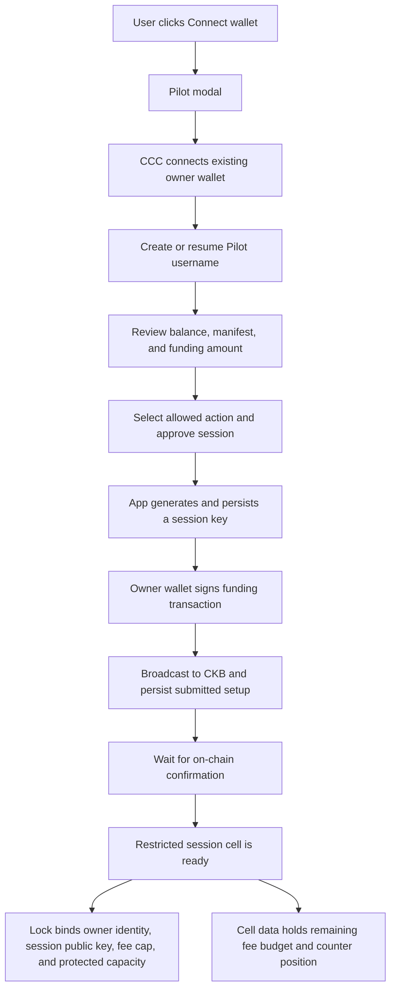
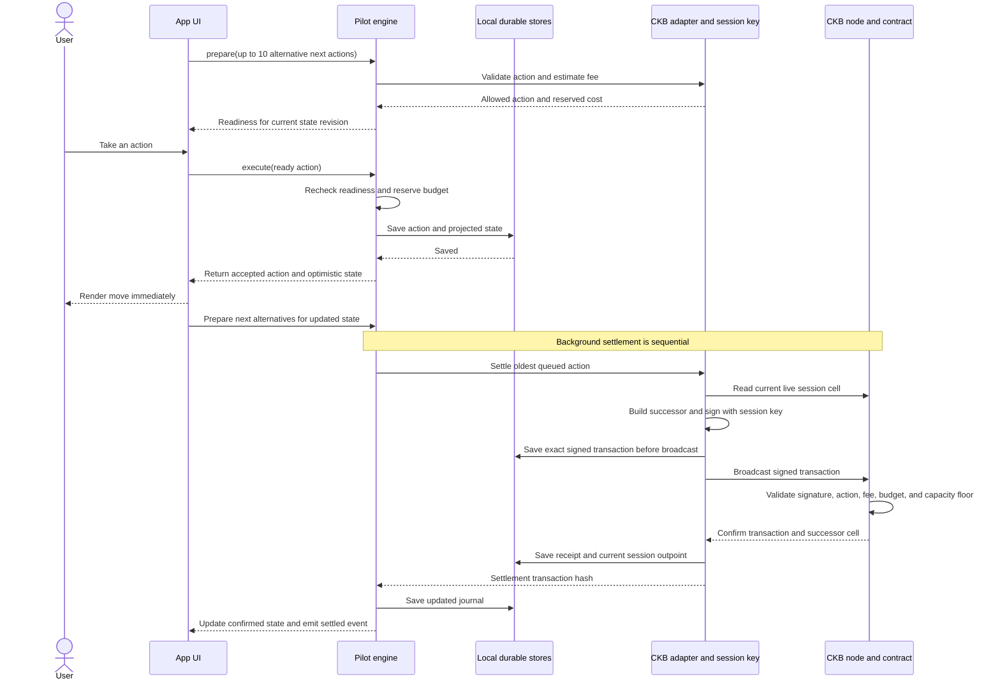
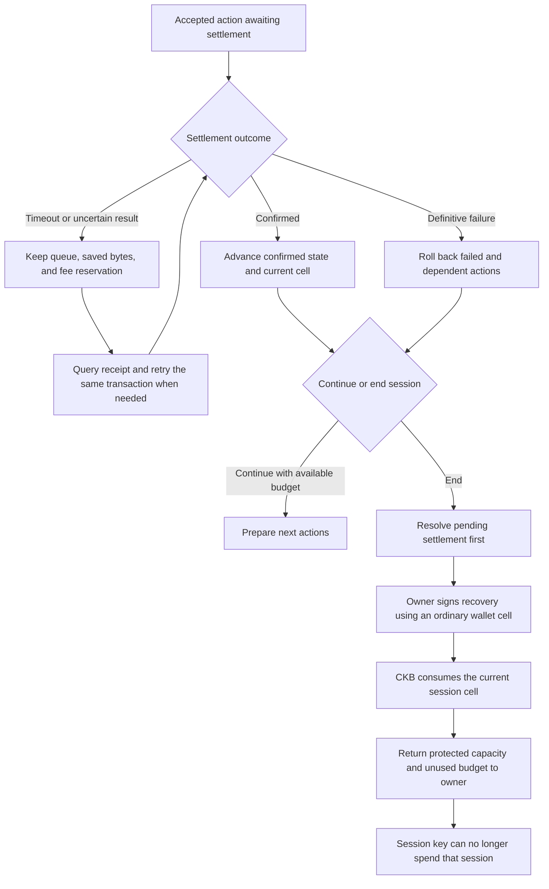

# Pilot

**Owl's Pilot** is a session SDK for CKB apps: approve a bounded session once, then interact instantly while transactions settle in the background.

Pilot includes an optimistic engine, the public-testnet counter integration, and a reusable cell-delegation lock with a developer setup API. Developers register named actions, state codecs, and transaction builders; users choose permissions and explicitly create or migrate one app cell. `npm run demo` remains a simulation; `npm run ckb` and `npm run delegation` submit real CKB transactions. Connecting an ordinary wallet alone does not grant a session key permission to spend its cells. This remains a bounded testnet/devnet prototype.

## Install into your app

From your existing npm app (Node.js 22+, Git, and curl):

```sh
curl -fsSL https://raw.githubusercontent.com/Birdmannn/owl/main/scripts/install-pilot.mjs | node --input-type=module -
```

The installer automatically includes the SDK, React 19 modal, and CCC wallet connector. It clones a sibling `pilot` checkout if needed, builds it, and installs local package copies. No npm or GitHub Packages publication is needed. If already cloned, run `node ../pilot/scripts/install-pilot.mjs` from your app. Use `--source PATH` for another checkout, `--app PATH` for another app, and `--help` for options.

Keep the checkout available for future installs. To update, pull your chosen revision there and re-run the installer. It refreshes the installed Pilot package copies even when their version is unchanged. The installer sets CCC core to `1.23.0` and `install-links=true` in your app’s `.npmrc`; commit that file and your app’s lockfile. In CI, restore and build the same Pilot revision before installing app dependencies. Wallet connection and app integration are described in the website Quickstart; the installer does not start services or edit app source.

## Run

```sh
npm install
npm run check
npm run demo
```

## Off-chain social signing

Pilot also supports scoped message delegation for likes, follows, posts, and other app-defined off-chain actions. The owner signs a grant once; `PilotOffchainSession` signs selected actions with a separate key. The receiving app verifies owner and session proofs and atomically enforces replay protection, revocation, and business rules. No CKB transaction or fee budget is required for these messages.

The demo’s **Pilot Social** panel works in explicitly labelled browser-local mode on a static HTTPS host. For shared state, an optional persistent Node verifier is included via `npm run social`; configure its audience and set `VITE_PILOT_SOCIAL_URL` before building. See [OFFCHAIN_SIGNING.md](OFFCHAIN_SIGNING.md) for APIs, diagrams, hosting, and verification limits, and the website’s **Off-chain signing** page. A reviewable community issue draft is in [CATALYST_FEEDBACK.md](CATALYST_FEEDBACK.md).

## Set up your app for cell delegation

Use `definePilotApp()` to supply a version-2 `PilotAppManifest`, `encodeState()`/`decodeState()`, and one `validate()`/`apply()`/`buildTransaction()` builder per named action. The manifest specifies human-readable names, operation labels, optional app type-script identity and cell dependency, cell-selection rules, transitions, deployment, and fee/capacity limits. See the complete [developer example](examples/cell-delegation.ts), [implementation guide](CELL_DELEGATION.md), and the website’s **Cell delegation** page.

`PilotConnector.prepareDelegation()` builds a review for a new app cell or an explicitly selected owner-locked cell. `authorize()` requests the owner signature only after review and persists signed bytes before broadcast. Empty selection stays connected without funding. The reusable lock commits the chosen subset and enforces it on-chain; an owner-only action cannot enter a grant. Unsupported migrations fail the signed dry-run rather than bypassing app rules.

`PilotDelegationAdapter` routes `{ id, params }` actions to the registered builders and independently checks their effects before session signing. The current lock supports fixed increments/decrements of a declared u64 field, preserving all other data, the app type script, the lock, and protected capacity. It does not support arbitrary multi-cell or NFT transitions. The SDK also provides reviewed owner-signed actions, confirmed-state reconciliation, and recovery that preserves app state and returns ownership.

Build and verify locally:

```sh
npm run contracts:build
# Separate terminal: offckb node
npm run delegation -- verify devnet
```

The verifier uses generated, ignored test keys and local faucet funds. Public evidence is in [the devnet proof](deployments/cell-delegation-devnet-proof.json). The browser demo includes a **Developer cell delegation** panel with selectable actions, explicit creation/migration, an owner-only jump, recovery, and detailed logs. It needs a real public testnet deployment JSON; one is not configured by default. The existing flight demo keeps its deployed counter policy.

## End to end: what happens behind the scenes

These diagrams describe the current browser demo and its `counter-v1` policy. The owner wallet controls the funds. Pilot generates a separate session key, and the CKB contract limits what that key can sign. The demo stores this key locally in the browser; it is not an isolated production key vault.

### 1. Connect, choose permissions, and fund the session

Clicking **Connect wallet** opens Pilot, which uses CCC to connect the existing owner wallet. The user creates or resumes a Pilot username, reviews their balance and the app manifest, and explicitly selects the supported action. A new username requires a separate wallet-signed ownership proof; it does not authorize spending.

Pilot then persists a session key and requests one owner signature for the funding transaction. The session becomes usable after that transaction confirms. The owner's private key stays in their existing wallet.



The browser demo funds **150.02 test CKB**, plus a separate setup transaction fee:

| Portion | Purpose | What happens to it |
| --- | --- | --- |
| 150 CKB | Protected capacity that holds the session cell | The session key cannot spend this portion; the owner can recover it. |
| 0.02 CKB | Fee budget for 20 moves at 0.001 CKB each | Each confirmed move deducts its fee; unused budget remains recoverable. |

These amounts are the demo's configuration, not universal SDK requirements. Funds are held in the user's contract-restricted cell, not a pooled Owl account. Other wallet funds remain outside the session key's authority.

### 2. Accept instantly, sign and settle in the background

The app supplies up to ten possible next actions. Pilot checks each against the current projected state, permission, local expiration, and available budget. Readiness is refreshed after state changes; it is not a permanently true flag or a search ten moves into the future.

When the user takes a ready action, Pilot reserves its fee and durably queues it before returning the optimistic state. The app can render immediately, without another owner-wallet popup or a pending badge on the move. The transaction inspector separately tracks actual settlement.



Every move consumes the current session cell and creates its successor with the same lock, counter increased by one, and capacity and fee budget reduced by 0.001 CKB. For example, after three confirmed moves, the cell holds **150.017 CKB**: 150 protected CKB plus 0.017 CKB of remaining budget. There is still one real CKB transaction per move.

The contract rejects extra payments, other actions, changed locks, invalid signatures, fees above the cap, budget overspending, and capacity below the protected floor. Username-based CKB and NFT transfers are separate owner-signed operations; the counter grant does not authorize them. This original deployment uses the user's funded fee budget. Separate sponsored policies and a fee service are now available; see [paymaster setup and accounting](PAYMASTER.md).

### 3. Handle interruptions and return the funds

Optimistic acceptance and on-chain confirmation are separate. A timeout retains the queue and fee reservation while Pilot checks the saved transaction and, when appropriate, resends the same signed bytes. A definitive settlement failure rolls back the failed action and its dependent actions to the last confirmed state.

To end the session, first resolve pending settlement. The owner signs a recovery transaction using the current session cell and an ordinary owner-wallet cell. Recovery returns the session's remaining capacity to the owner wallet; the owner pays a separate recovery fee. Consuming that session cell removes the session key's authority over it.



Exhausting the budget stops new automatic moves; it does not consume the protected capacity. Local session expiry also stops new actions in the SDK, but the current contract has no on-chain expiry: the owner must recover the session to revoke its on-chain authority.

## Execution model

1. The app supplies up to ten possible next actions to `pilot.prepare()`.
2. An adapter prevalidates each against projected state, session policy, and unreserved budget.
3. `pilot.readiness(moveId).ready` becomes true only for an allowed, affordable action at the current state revision.
4. `pilot.execute(moveId)` reserves budget and durably saves the action before exposing its optimistic state. It does not wait for wallet approval or chain confirmation.
5. Pilot settles queued actions sequentially through the adapter. Each production action still becomes a CKB transaction.
6. After accepting an action, the app prepares the next possibilities again. These are alternative next actions, not a ten-level search tree.

Use `pilot.state` to render the optimistic app state. `confirmedState`, events, and `queueLength` are available for reconciliation and diagnostics; a pending badge per move is not required. Local acceptance is not a guarantee of chain settlement.

```ts
await pilot.prepare(possibleMoves);
if (pilot.readiness('forward').ready) {
  await pilot.execute('forward');
  render(pilot.state);
  await pilot.prepare(nextMoves(pilot.state));
}
```

Costs are nonnegative `bigint` integer shannons. State and actions must be JSON-serializable. Estimates must reserve the full allowed cost, including fees and capacity costs where applicable. Confirmed costs conservatively consume the full reservation in this version.

## Adapter contract

`validate()` checks permissions and action validity. `apply()` must be pure and deterministic. `settle()` builds, signs, broadcasts, and waits for confirmation; it must never exceed `reservedCost`.

Every settlement has a stable ID. An adapter must durably map that ID to its signed transaction before broadcasting and reconcile the same transaction on retry, including after process restart. It must not build a fresh payment blindly after a timeout.

Unknown failures retain the queue and reservations. Call `flush()` after reconnecting or on a retry schedule. Throw `PermanentSettlementError` only when the action definitely cannot have settled. A definitive rejection rolls back the failed action and all dependent queued actions to the last confirmed state. Observer callbacks cannot interrupt execution.

The core checks local session expiration at acceptance. The adapter must reconcile previously submitted transactions even after expiry, and enforce actual on-chain authority. Local checks do not substitute for chain policy enforcement. Call `invalidate()` when external information changes; an adapter must still check fresh cell availability and policy before submission.

## Storage and concurrency

`MemoryStore` is for tests and demos. `LocalStorageStore` persists a journal across browser reloads. Use one live Pilot instance per storage key; multiple tabs require an exclusive lease or transactional store, which is not implemented here. A store must atomically replace its journal, leaving the prior record intact on failure. Restored journals are trusted local data, not cryptographic authorization.

Actions reserve budget serially, preventing two rapid clicks from spending the same allowance. Settlement is sequential. Chains of unconfirmed CKB transactions, transaction batching, authoritative external state reconciliation, and parallel budgets are future adapter/protocol work. The counter adapter persists exact signed transaction bytes before broadcasting and checks confirmed chain receipts on retries.

## Real CKB counter prototype

The owner wallet funds a cell containing a counter and cumulative fee budget. Its lock binds the owner lock hash, session public key, per-move fee limit, and minimum preserved capacity. The session key can advance the counter by exactly one; the on-chain script rejects other moves, extra payments, lock changes, invalid signatures, and overspending. Owner recovery consumes the session cell to revoke it.

`authorizeCounter(ownerSigner, options)` and `revokeCounter(ownerSigner, ...)` accept an existing CCC signer, including a signer obtained from the CCC wallet connector. `CkbCounterAdapter` handles session-key signing and real background settlement without invoking the owner signer for each move. The CLI uses a generated test-only private-key signer to verify the flow automatically; a browser wallet popup flow has not been manually tested.

See [contract format and limits](contracts/README.md). This version has **local expiration only**, a fixed counter policy, and sequential settlement. The architecture's separate authority cell, app policy modules, embedded signer isolation and on-chain expiration are not implemented yet. Sponsored variants require their own deployment and service; see [PAYMASTER.md](PAYMASTER.md).

### Local chain

With offCKB installed:

```sh
offckb node
# In another terminal:
mkdir -p .pilot/devnet
offckb system-scripts --export-style ccc --network devnet > .pilot/devnet/system-scripts.txt
npm run contracts:build
npm run ckb -- address devnet
# Fund the displayed address with 100,000 devnet CKB:
offckb deposit <displayed-address> 100000 --network devnet
npm run ckb -- deploy devnet
npm run ckb -- authorize devnet
npm run ckb -- move devnet
npm run ckb -- reject devnet
npm run ckb -- move devnet
npm run ckb -- revoke devnet
```

### Public testnet

A verified deployment and transaction history are recorded in [deployments/testnet.json](deployments/testnet.json). Run `npm run testnet:verify` to independently check live code, committed authorization and moves, budget changes, and revocation against the public RPC. Rejection evidence comes from node CKB-VM dry-runs.

```sh
npm run ckb -- address testnet
npm run ckb -- faucet testnet
# Fund the displayed address with enough test CKB for the ~94,000 CKB code cell.
npm run ckb -- deploy testnet
npm run ckb -- authorize testnet
npm run ckb -- move testnet
npm run ckb -- reject testnet
npm run ckb -- move testnet
npm run ckb -- revoke testnet
```

The default session has a 300,000-shannon fee budget and a 100,000-shannon fee per move, allowing three moves. Run rejection checks after the first move while sufficient budget remains to construct both deliberately invalid transactions. `reject` invokes the node's actual CKB-VM via dry-run; rejected transactions never become on-chain records.

`move` prints the optimistic position immediately after durable local acceptance, then waits for actual chain confirmation. `resume` retries existing queued transactions without creating another action. Confirmations wait for inclusion plus one subsequent block; they do not guarantee immunity from deeper reorgs.

Keys and execution journals are stored under git-ignored `.pilot/<network>/`. The CLI creates random test-only keys, stores them with owner-only file permissions, and never prints them. It saves transaction bytes before broadcast. Do not delete journals with unresolved transactions, share these key files, or run concurrent CLI instances for the same session. The deployed code cell remains funded after session revocation; its capacity is separate from the session's preserved capacity.

For a browser integration, use the CCC connector's signer as the owner and provide durable Pilot and settlement stores. The session-key custody design must be integrated separately; this prototype does not isolate a browser session key from app JavaScript.

```sh
npm run check:all
```

The package remains private while the protocol and wallet integrations are developed.


## Signing security and profile history

The connected Pilot modal includes expandable **Activity & logs** for recorded on-chain and off-chain actions, with per-action timelines and owner filtering. Integrators wire public action metadata through `recordPilotActivity` or supply the modal's `activity` prop. This local history is not a global ledger or authorization proof.

Read [SECURITY_AUDIT.md](SECURITY_AUDIT.md) before using signing flows. This review hardened builder snapshots, reviewed wallet effects, account restoration, and settlement records. New setup rejects unsupported or permissionless owner-lock configurations. The underlying owner-input contract assumption remains; raw browser key storage and local-only on-chain expiry also remain unresolved. Pilot is a bounded testnet prototype, not a production key vault or independently certified wallet.

## Pool-paid network fees

Pilot can use Owl’s pool through `PilotPaymasterClient`. Sponsored counter and reusable-delegation policies preserve the user’s app-cell capacity. The pool input/change pays the entire CKB network fee; users still provide their storage capacity, transfers, and app payments. There is no automatic user-paid fallback.

This is implemented and tested in the SDK/service and CKB VM, but is **not activated on public testnet**: both new contract code cells are deployed and verified live, and the pool service still requires its matching server-only key and demo configuration. The configured receiving address was verified at **100,000 test CKB** on October 18, 2026. Existing v1 sessions still pay their own fees. See [PAYMASTER.md](PAYMASTER.md) for activation, integration, retry behavior and limits.

## Host the demo and backend on Vercel

The root [vercel.json](vercel.json) serves the demo and username/social/paymaster APIs in one project. Import the repository with the root directory unchanged, configure a pooled `DATABASE_URL`, comma-separated exact `PILOT_APP_ORIGINS`, a stable `PILOT_REGISTRY_ORIGIN`, the demo-specific `PILOT_SOCIAL_AUDIENCE`, the server-only pool key, and public API build URLs. See [VERCEL.md](VERCEL.md) for deployment steps and verification. PostgreSQL now stores paymaster quotes/retry bytes/leases/accounting and social state/receipts/revocations as well as usernames; database row locks coordinate concurrent function instances. Serverless requests require PostgreSQL and fail closed without it. Standalone Node services retain JSON fallback when no database URL is set. Existing JSON data is not imported automatically.
